<div align="center">


# PromptForge

**Turn rough ideas into excellent, platform-tailored AI prompts — and see exactly why they work.**

You type a rough idea. PromptForge interviews you, drafts a prompt tailored to the
platform you'll run it on, scores it against an auditable 8-dimension rubric, and
shows its work node by node.

[](#tech-stack)
[](#tech-stack)
[](#tech-stack)
[](#tech-stack)
[](#tech-stack)
[](#tech-stack)
[](#tech-stack)
[](#tech-stack)

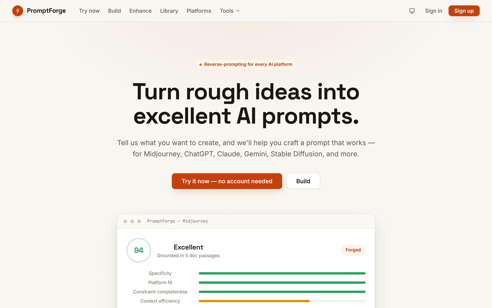

</div>

---

## Contents

- [Who it's for](#who-its-for)
- [Screenshots](#screenshots)
- [Key features](#key-features)
- [Tech stack](#tech-stack)
- [The problem](#the-problem) · [The approach](#the-approach) · [The scoring rubric](#the-scoring-rubric)
- [Architecture](#architecture)
- [Supported platforms](#supported-platforms)
- [Project structure](#project-structure)
- [Getting started](#getting-started)
- [Configuration](#configuration)
- [Running in development and production](#running-in-development-and-production)
- [Usage](#usage)
- [Scripts and commands](#scripts-and-commands)
- [API reference](#api-reference)
- [Testing](#testing) · [Linting and formatting](#linting-and-formatting)
- [Deployment](#deployment)
- [Data model](#data-model)
- [Troubleshooting and FAQ](#troubleshooting-and-faq)
- [Known limitations](#known-limitations) · [Roadmap ideas](#roadmap-ideas)
- [Contributing](#contributing) · [Documentation](#documentation) · [License](#license)

---

## Who it's for

- **People who use AI tools daily but aren't prompt engineers** — marketers, writers,
  designers, students — and want consistently good results without memorising each
  model's quirks.
- **Developers and power users** who want prompts they can version, diff, test for
  regressions, chain into workflows and port between platforms.
- **Teams** who want a shared library of proven prompts and a house style that is
  enforced rather than hoped for.

PromptForge runs as a web app, a Chrome/Firefox overlay that drafts inside the AI
tool you're already using, an Electron desktop app, and a native macOS menu-bar app —
all backed by one API.

---

## Screenshots

All screenshots were captured from the running web app in this repository. The result
screens were produced with the backend's `PROVIDER_FORCE_MOCK=true` mode (a
deterministic mock model, so no API keys are needed); with real provider keys the
prompt text and scores come from live models instead.

| Build: guided clarification | Build: scored, editable result |
|---|---|
| 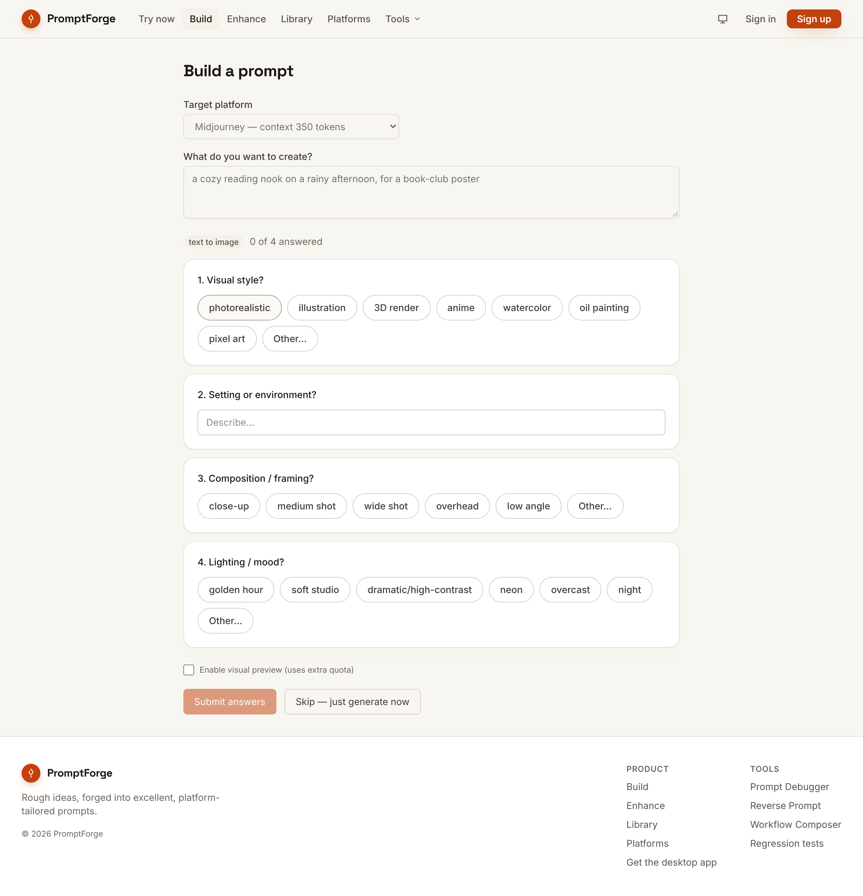 | 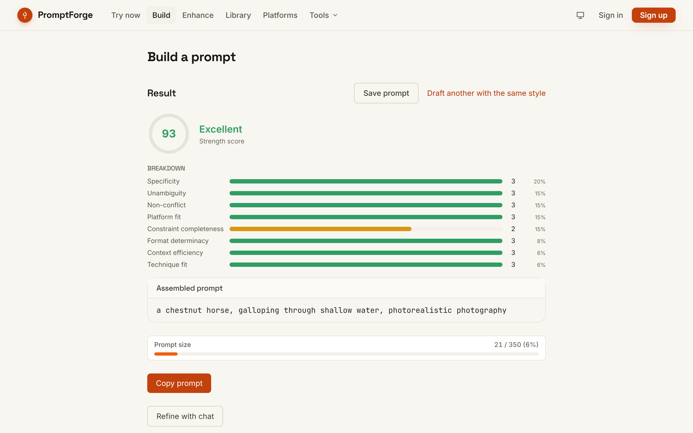 |

| Enhance an existing prompt | No-account demo (`/try`) |
|---|---|
| 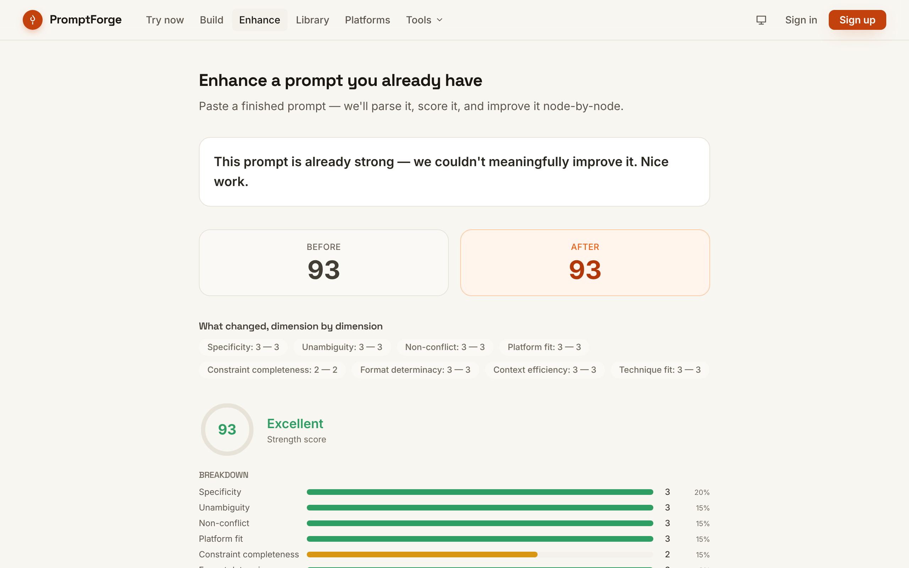 | 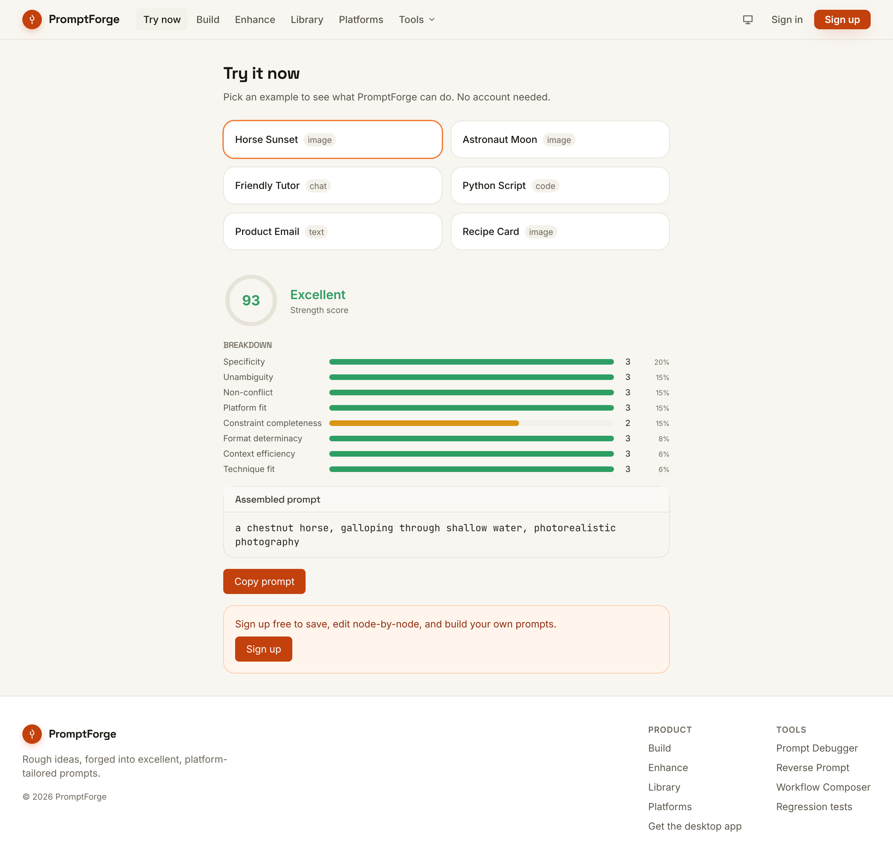 |

| Prompt library | Library detail |
|---|---|
| 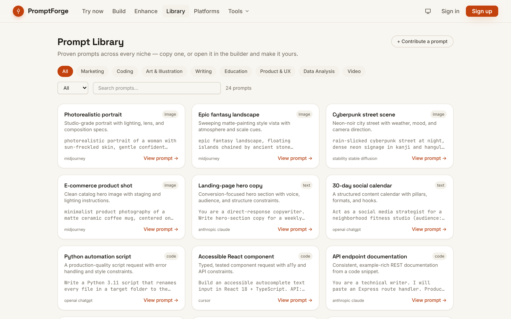 | 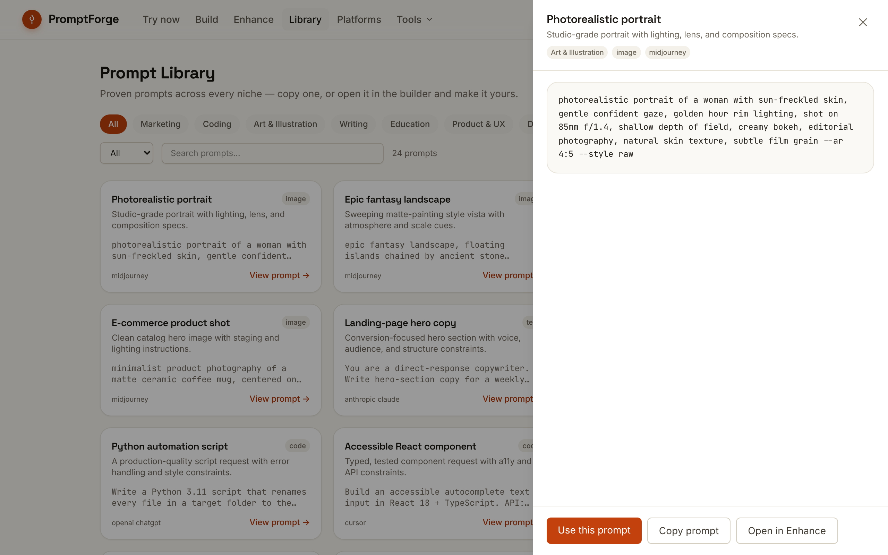 |

| Platform guides | Per-platform guide |
|---|---|
| 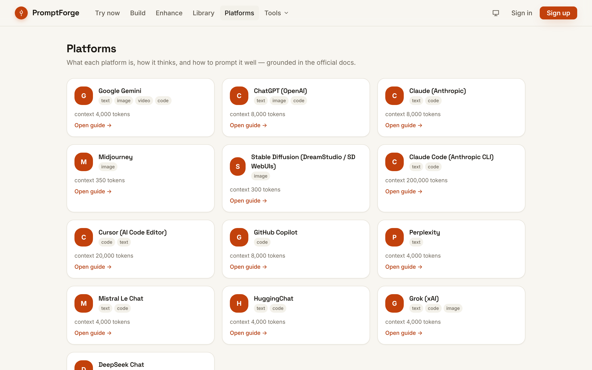 | 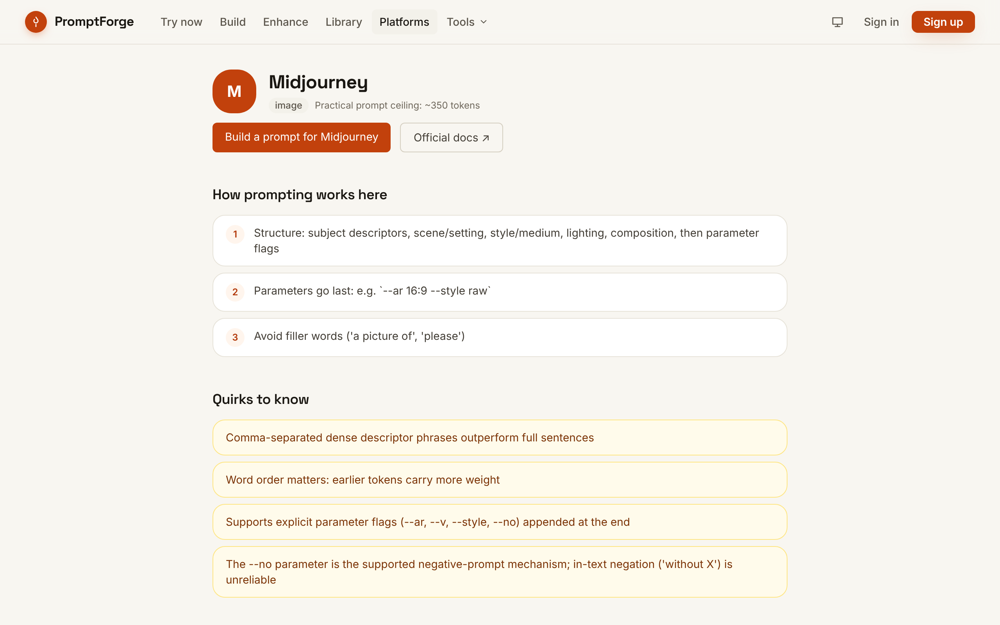 |

| Dark mode | Prompt debugger |
|---|---|
| 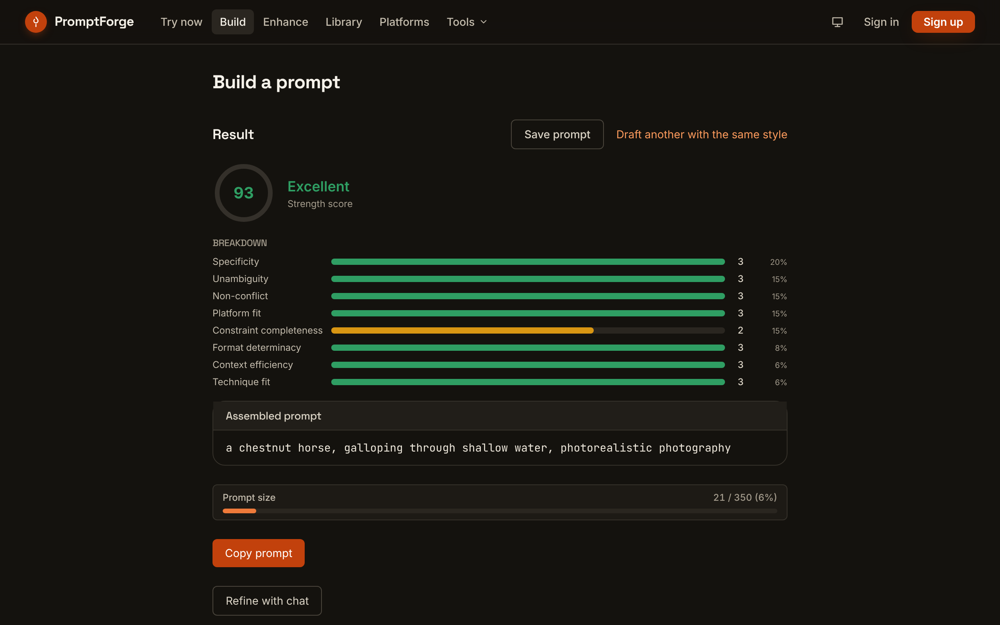 | 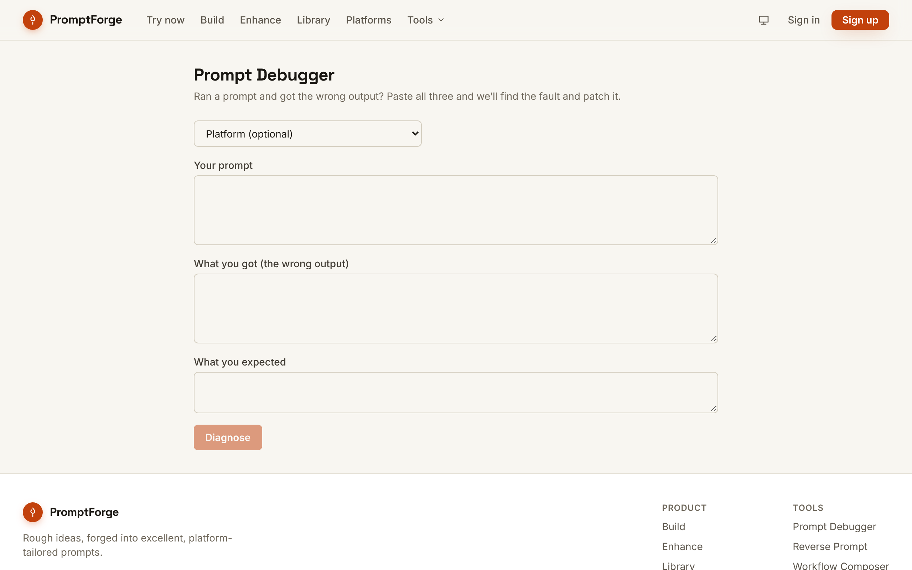 |

<table>
<tr>
<th>Phone: landing</th><th>Phone: navigation menu</th><th>Phone: result</th>
</tr>
<tr>
<td>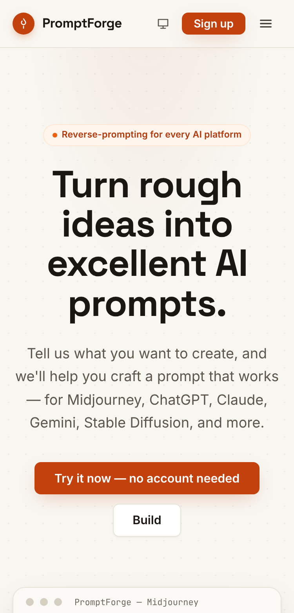</td>
<td>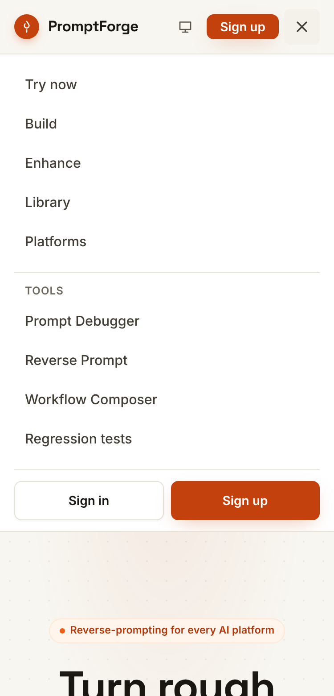</td>
<td>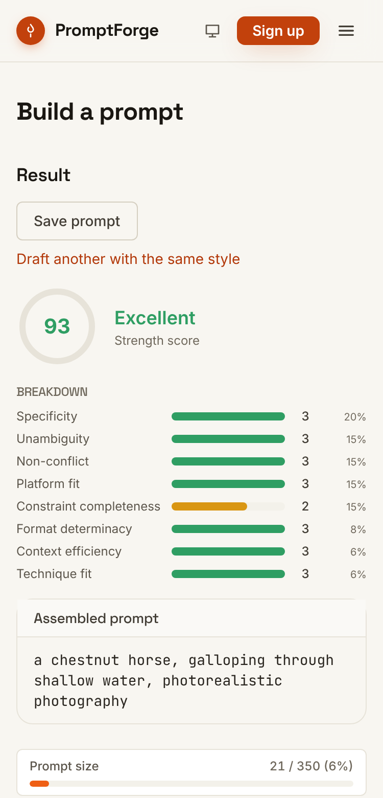</td>
</tr>
</table>

More in [`docs/screenshots/`](docs/screenshots/) (dark landing and library, 404 page).

---

## Key features

- **Guided drafting** — up to four targeted clarifying questions (or "just generate"),
  then a prompt built from 11 typed, individually editable nodes.
- **Platform-tailored output** — 13 platforms in a JSON registry (Midjourney, Claude,
  ChatGPT, Gemini, Stable Diffusion, Cursor, …), each with its own syntax rules, quirks,
  modes and token ceiling; custom platforms can be profiled from a docs URL.
- **Scored, not guessed** — every draft gets a 0–100 Prompt Strength Score from an
  8-dimension rubric, with per-dimension sub-scores and bounded auto-refinement.
- **Enhance mode** — paste a finished prompt to get it parsed, scored and improved, with
  a before/after delta per dimension and an honest "already strong" verdict.
- **Node editor** — edit, lock, regenerate or swap alternatives per node; refine by chat.
- **Analysis tools** — prompt debugger, reverse prompting, ambiguity analysis, style
  linter, cross-platform migration, cost simulator, workflow composer, regression tests.
- **Model recommendation** — ranks models for a task on quality, cost and speed.
- **Library** — 24 curated prompts across 8 niches; community submissions go through
  moderation.
- **Memory, projects, versions, sharing, teams** — immutable version chains with diff and
  restore, revocable share links, cross-session memory, project defaults.
- **Safety and privacy by construction** — fail-closed content gates, encrypted user
  content, BYOK key custody with no read path, append-only audit log.
- **Accessible, responsive web UI** — keyboard-navigable, labelled forms, WCAG AA colour
  contrast, light/dark/system theme, mobile navigation, ⌘K command palette, guided tour.
- **Everywhere you prompt** — Chrome and Firefox overlays, Electron desktop app, native
  macOS menu-bar app and an embeddable Swift SDK.

### Feature details

<details open>
<summary><b>Drafting & enhancement</b></summary>

Conversational or form-based drafting · file attachments (text, code, CSV, JSON, PDF) ·
voice dictation via Groq Whisper · natural-language refinement ("make it more dramatic") ·
paste-to-enhance with before/after per-dimension deltas · honest "already strong" detection ·
degraded mode that returns the best partial result rather than failing.

</details>

<details>
<summary><b>Analysis tools</b></summary>

**Prompt Debugger** — paste prompt + actual output + expected output, get a diagnosis and a patch.
**Reverse Prompt** — paste an output, infer the prompt that could produce it.
**Ambiguity Analysis** — highlights risky spans with fixes.
**Style Linter** — enforce banned/required terms, length, tone, required nodes.
**Migration** — port a prompt across platforms with a change report.
**Cost Simulator** — estimate spend across models before committing.
**Workflow Composer** — chain prompts so each step's output feeds the next as a variable.
**Regression Tests** — assertion-backed test cases that catch prompt rot.

</details>

<details>
<summary><b>Intelligence</b></summary>

Model recommendation across 345 OpenRouter models with live pricing, always shown as a
quality/cost/speed trade-off rather than a bare winner · Token Governor with platform-ceiling
checks and near-limit warnings · Token-Reduction Advisor (PDF→Markdown, prose→CSV, base64→refs) ·
live text preview of what you'll likely get · document-grounding citations showing which doc
passage informed each suggestion.

</details>

<details>
<summary><b>Memory, versioning & collaboration</b></summary>

Cross-session memory with global and project scopes, agent-proposed entries held pending your
confirmation · Projects with pinned context and default platforms · immutable version chains
with restore and node-level diff · revocable public share links that re-run the safety classifier
before publishing and expose zero owner identity · teams with member management.

</details>

<details>
<summary><b>Safety, privacy & compliance</b></summary>

**Three gates, all failing closed.** A pre-flight classifier runs before any tokens are
spent; post-generation validation runs on the draft before it reaches you; a third gate
runs again at library-publish and share-link time, because content that was fine
privately isn't automatically fine publicly. When the classifier is unavailable the
request is **blocked, not allowed** — the expensive default rather than the convenient
one. A `HeuristicScorer` runs in parallel as a cheap independent signal, and every
decision lands in an append-only `audit_log` that migration `004` revokes UPDATE and
DELETE on. Blocked prompts can be appealed via `POST /appeal`.

**Privacy by construction.** Prompt content is never logged — the pino logger emits
structured events with token counts, durations, and state transitions, never text.
User content persists only in `*_ciphertext` columns; decrypted plaintext exists in
process memory for the duration of one request. Audio uploaded for dictation is never
persisted and the transcript is never logged.
[`docs/data-classification.md`](docs/data-classification.md) marks every field
plaintext / encrypted / never-persisted, so the boundary is auditable rather than
implied.

**BYOK.** Bring your own OpenAI or Gemini key. Keys are stored as encrypted,
non-retrievable references through `KeyCustody` — there is no read path that returns a
key, only a use path. Connections are individually revocable with per-connection usage
metering.

**Transport & abuse controls.** Per-user, per-endpoint rate limiting backed by a
`rate_limits` table · 100 KB request body cap · CORS allowlisting · HSTS and security
headers on every response · pre-flight budget checks that refuse before spending.

**Compliance.** Documented retention schedules (sessions 90d, usage 24mo), incident
response plan, subprocessor register, acceptable-use policy, and data portability via
`GET /export` and `DELETE /me`.

</details>

<details>
<summary><b>Experience</b></summary>

⌘K command palette · 4-step guided tour · honest step-by-step pipeline progress (real states,
not a fake spinner) · teaching mode that explains *why* a structure works · visual indicators for
defaulted nodes · i18n with locale overlay merging · curated library of 20+ battle-tested templates
across 8 niches, remixable in the builder.

</details>

---

---

## Tech stack

| Layer | Technology |
|---|---|
| Web app | Next.js 16 (App Router, static export), React 19, Tailwind CSS 4, TypeScript |
| API | Node.js 22, Hono, Zod validation, pino logging — packaged as one AWS Lambda ("Lambdalith") |
| Data | Postgres with `pgvector` (Supabase), numbered SQL migrations |
| Auth | Supabase Auth; the API verifies JWTs via JWKS (or a shared secret) |
| LLM providers | Groq (default), Google Gemini, Cerebras, OpenCode Zen, OpenRouter catalogue — routed per pipeline step by config |
| Payments | Stripe Checkout + webhook (optional) |
| Browser extensions | Manifest V3, React 19, Vite 8 (Chrome and Firefox) |
| Desktop | Electron 45, esbuild, React renderer on Vite |
| macOS | Swift, SwiftUI menu-bar app; Swift Package SDK |
| Admin plane | Separate Hono service with Supabase service-role access |
| Testing | Jest (backend, admin, desktop), Vitest + jsdom (extension) |
| Tooling | ESLint 9 (typescript-eslint, react-hooks, eslint-config-next), GitHub Actions, gitleaks |
| Hosting | Cloudflare Pages (web), AWS Lambda + API Gateway (API), AWS SSM for secrets |

---

## The problem

Everyone writing prompts is doing the same thing: typing something vague, getting
something mediocre, then poking at it until it works. There's no feedback signal,
no explanation, and no transfer of skill — you learn nothing that survives to the
next prompt.

The advice available is worse than useless. "Prompt engineering guides" are folklore
lists scraped from Twitter, most of them wrong for the model you're actually using.
Midjourney rewards dense visual descriptors; Claude rewards structure and explicit
constraints; a diffusion model with no negative-prompt support silently ignores your
`--no watermark`. Generic advice cannot know this.

---

## The approach

PromptForge treats a prompt as a **structured object**, not a blob of text.

```
rough idea  →  intent classified  →  docs retrieved  →  clarified  →  drafted
                                                                        ↓
                     you  ←  scored + explained  ←  ranked  ←  critiqued
```

Every prompt decomposes into **11 typed nodes** — `subject`, `action_behavior`,
`setting_context`, `style_aesthetic`, `composition_camera`, `lighting_mood`,
`persona_role`, `constraints_rules`, `technical_parameters`, `negative_prompt`,
`output_format`. Nodes are individually editable, lockable, redraftable, and
re-serializable per target platform. The same node set fans out to Midjourney
syntax and Claude syntax without being rewritten.

### Anatomy of a node

A node is not a string. It carries its own provenance, alternatives, and edit state:

```ts
{
  type:         'style_aesthetic',   // one of the 11 typed slots
  value:        'photorealistic, cinematic wide shot',
  rationale:    'Midjourney PKB: dense descriptor phrases outperform sentences',
  alternatives: [                    // up to 4, each ranked with a reason
    { value: 'watercolor illustration', rationale: '…', rank: 1 },
  ],
  locked:       false,               // refinement must not touch this node
  position:     3,                   // serialization order
  defaulted:    true,                // filled by "just generate now", never confirmed
}
```

Two of these fields carry most of the design weight. `locked` is what makes
refinement safe — the Critic can only rewrite what you haven't pinned. `defaulted`
is what makes it honest: when you skip clarification, the UI visibly marks every
node the system guessed rather than quietly presenting assumptions as your intent.

Every draft is scored by a **Critic Agent** against a versioned rubric. Any
dimension scoring 1/3 triggers a bounded refinement pass that fixes *only* the
flagged nodes — locked-node discipline, hard cap of 2 passes, no infinite loops,
no silent rewrites of things that already worked.

### Serialization is per-platform

Nodes are stored once and rendered per target. The same set becomes:

```
Midjourney   chestnut horse mid-gallop, dust trailing, open prairie,
             golden hour, photorealistic --ar 16:9 --style raw
             └─ descriptors comma-separated, weight front-loaded, flags last

Claude       <role>You are a photography director.</role>
             <task>Describe a chestnut horse mid-gallop…</task>
             <constraints>Under 100 words. No jargon.</constraints>
             └─ structural tags, explicit constraint block
```

That difference is not hardcoded. It comes from the platform registry entry's
`syntax_rules`, `quirks`, and `max_prompt_tokens` — so adding a platform is a
JSON edit, not a code change.

---

---

## The scoring rubric

Eight dimensions, each scored 1–3, weighted to a 0–100 **Prompt Strength Score**.
This is a real document ([`docs/quality-rubric.md`](docs/quality-rubric.md)), versioned
like code, and shared by the Critic Agent, the Alternatives Agent, and the user-facing
score — so "excellent" means exactly one thing everywhere.

| # | Dimension | Weight | Fails when |
|---|---|:---:|---|
| 1 | **Specificity** | 20 | Vague adjectives doing a description's job — "a nice image of a horse" |
| 2 | **Unambiguity** | 15 | Two reasonable readers picture different things — "draw a bat by the window" |
| 3 | **Non-conflict** | 15 | Nodes contradict — "ultra-minimalist" + "cluttered workshop overflowing with tools" |
| 4 | **Platform-fit** | 15 | Syntax the target platform doesn't support, or ignoring its documented strengths |
| 5 | **Constraint completeness** | 15 | The user said "under 100 words, no jargon" and neither survived into the draft |
| 6 | **Format determinacy** | 8 | Extraction task shipped with no output schema |
| 7 | **Context efficiency** | 6 | Filler, repetition, or blowing past the platform's practical token ceiling |
| 8 | **Technique fit** | 6 | Zero examples on a task the model KB says measurably benefits from few-shot |

```
strength = Σ ( (score_d − 1) / 2 × weight_d )

0–39 Needs work  ·  40–69 Solid  ·  70–89 Strong  ·  90–100 Excellent
```

Sub-scores always ship alongside the total. The score is evidence, not a vibe —
and refinement triggers on *any* dimension hitting 1, never on the aggregate.

<details>
<summary><b>Worked example</b></summary>

**Before** — `"make a nice image of a dog"`
Specificity 1 · Unambiguity 2 · Non-conflict 3 · Platform-fit 1 · Constraints 3 ·
Format 3 · Efficiency 3 · Technique 1 → **52 "Solid"**, but two 1-scores force refinement.

**After** — `"golden retriever puppy mid-leap catching a red frisbee, backyard lawn,
late-afternoon sun, shallow depth of field, photorealistic, 16:9 --style raw"`
→ **100 "Excellent"**

</details>

---

---

## Architecture

A **Supervisor** owns a 13-state pipeline machine and decides which agent runs next.
It looks agents up from a registry and knows nothing about any agent's internals —
so adding a capability never means editing the orchestrator.


### System overview

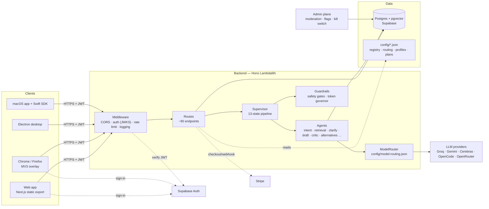

### Drafting pipeline

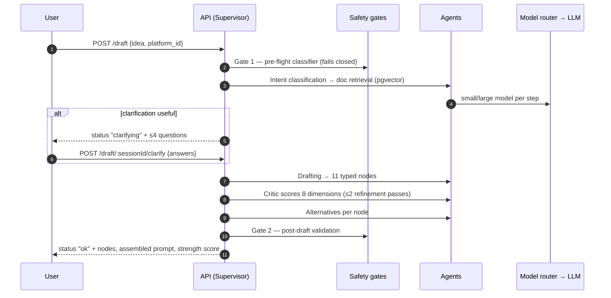

### Pipeline states

**Pipeline states** — `created → context_resolved → intent_classified → docs_retrieved →
clarifying → awaiting_clarification → drafting → critiqued → alternatives_attached →
governed → ready_for_review`, plus terminal `blocked_by_safety` and `failed`.

**Enhance mode** skips intent and clarification: a `PromptImportAgent` parses a pasted
prompt straight into nodes at the `drafting` state — so safety gate 2 still fires. If the
refined version doesn't beat the original, you're told honestly that it was already strong.

### The 13 agents

| Agent | Job |
|---|---|
| `IntentClassificationAgent` | Task type + modality from a rough idea |
| `DocRetrievalAgent` | RAG over the Platform Knowledge Base (pgvector) |
| `ClarifyingQuestionAgent` | ≤4 MCQ/free-text questions, with a "just generate" escape hatch |
| `DraftingAgent` | Idea + answers + retrieved docs → typed node set |
| `CriticAgent` | Scores the 8 dimensions, emits actionable per-node issues |
| `AlternativesAgent` | 2–4 ranked alternatives per node, each with rationale |
| `PromptImportAgent` | Parses a finished pasted prompt back into nodes |
| `MemoryExtractionAgent` | Proposes durable preferences from session behavior |
| `ModelRecommenderAgent` | Ranks models against modality/latency/cost/quality constraints |
| `ModelRefreshAgent` | Refreshes the capability matrix from provider docs |
| `OpenRouterModelFetcher` | Live pricing + capabilities across 345 models |
| `PlatformProfileAgent` | Reads a docs URL and profiles an unknown platform |
| `CurationAgent` | Mines opted-in sessions for high-value library patterns |

### Per-step model routing

No single model runs the whole pipeline. Each step declares a complexity class and
routes to a model chosen for that job — cheap and fast where the work is mechanical,
large-context where it isn't. The entire table lives in
[`config/model-routing.json`](config/model-routing.json):

| Pipeline step | Class | Routed to | Why |
|---|---|---|---|
| `intent_classification` | small | Groq · `openai/gpt-oss-20b` | Sub-second, trivially structured output |
| `clarifying_questions` | small | Groq · `openai/gpt-oss-20b` | Short, templated generation |
| `drafting` | large | Gemini · `gemini-flash-latest` | 1M context, strict JSON, doc grounding |
| `critic` | large | Gemini · `gemini-flash-latest` | Must hold rubric + docs + draft at once |
| `prompt_import` | large | Gemini · `gemini-flash-latest` | Parsing arbitrary pasted prompts |
| `chat_draft` / `chat_refine` | large | Gemini · `gemini-flash-latest` | Multi-turn context retention |
| `platform_profile` | large | Gemini · `gemini-flash-latest` | Reads and profiles whole doc sites |
| `debug` / `reverse` / `migrate` / `ambiguity` | large | Cerebras · `gpt-oss-120b` | Analytical reasoning over one artifact |
| `alternatives` / `judge` / `lint_tone` | small | Groq · `openai/gpt-oss-20b` | High call volume, narrow scope |
| `memory_extraction` / `preview` | small | Groq · `openai/gpt-oss-20b` | Background, latency-sensitive |
| `transcription` | small | Groq · `whisper-large-v3-turbo` | Speech-to-text |
| `image_preview` | small | Gemini · `imagen-3.0-generate-001` | Visual preview generation |

Swapping providers is a config edit. Every route falls back to the file-level
`default`, so a partially-specified table is still valid.

### Strategy profiles

Task type determines *how* a prompt should be built, not just what goes in it.
Six versioned profiles in [`config/strategy-profiles.json`](config/strategy-profiles.json)
each define a drafting template, which nodes are required, and which elicitation
technique the model knowledge base says actually helps:

`text_to_image` · `text_to_video` · `chat_persona` · `reasoning_code` ·
`extraction_classification` · `long_form_writing`

This is why an extraction task without an output schema scores 1 on format
determinacy while an image prompt with no schema scores 3 — the profile decides
what "complete" means for that shape of work.

### Engineering rules

These are enforced, not aspirational:

- **One-way dependency flow** — `handlers → services → agents/guardrails → utils/types`. Never backwards.
- **Config over code** — no hardcoded thresholds, models, or platform data. Swap the LLM provider by editing [`config/model-routing.json`](config/model-routing.json), not source.
- **Privacy by construction** — prompt content is never logged. User content persists only in `*_ciphertext` columns. Decrypted text exists in memory, for the length of one request.
- **Safety fails closed** — if the content classifier is unavailable, the request is blocked, not allowed.
- **Everything is tested** — every service, agent, and route.
- **Migrations are numbered and idempotent** — 24 files (`001`–`022`), forward-only.

---

---

## Supported platforms

Thirteen platforms in the registry, each with its own rules, quirks, modes, and token
ceilings — plus **custom platform support**: paste any documentation URL and the
`PlatformProfileAgent` reads it and generates a registry entry on the fly.

| Platform | Modality | Model family | Notable registry entries |
|---|---|---|---|
| Google Gemini | text, image | `gemini` | Multiple modes with per-mode `best_for` routing |
| ChatGPT | text, image | `gpt` | Mode selection across reasoning and vision variants |
| Claude | text | `claude` | Rewards structural tags and explicit constraint blocks |
| Claude Code | text, code | `claude` | CLI-oriented; file and tool context conventions |
| Midjourney | image | `diffusion_image` | `--ar/--v/--style/--no` flags; `niji` vs `v7` modes |
| Stable Diffusion | image | `diffusion_image` | True negative-prompt field; weight syntax |
| Cursor | code | `mixed` | Editor-context prompting |
| GitHub Copilot | code | `mixed` | Inline completion conventions |
| Perplexity | text, search | `mixed` | Retrieval-first phrasing |
| Mistral Le Chat | text | `mistral` | — |
| HuggingChat | text | `mixed` | — |
| Grok | text | `grok` | — |
| DeepSeek | text, code | `deepseek` | — |

### What a registry entry contains

The registry is the single source of platform truth — consumed by the drafting agent,
the serializer, the Critic's platform-fit dimension, *and* the browser extension's
detection logic. One entry, four consumers:

```jsonc
{
  "platform_id": "midjourney",
  "display_name": "Midjourney",
  "modalities": ["image"],
  "model_family": "diffusion_image",
  "max_prompt_tokens": 350,           // feeds the Token Governor's ceiling check

  "url_patterns": ["https://www.midjourney.com/*", …],   // extension: where to inject
  "dom_fingerprint_selectors": ["#imagine-bar", …],      // extension: confirm the page
  "input_selector_candidates": ["#imagine-bar input", …],// extension: where to insert

  "quirks": [                          // Critic scores platform-fit against these
    "Comma-separated dense descriptor phrases outperform full sentences",
    "Word order matters: earlier tokens carry more weight",
    "The --no parameter is the supported negative-prompt mechanism;
     in-text negation ('without X') is unreliable"
  ],
  "syntax_rules": [                    // serializer renders according to these
    "Structure: subject, scene, style, lighting, composition, then flags",
    "Parameters go last: e.g. `--ar 16:9 --style raw`"
  ],

  "modes": [                           // mode recommendation matches task → mode
    { "mode_id": "v7",   "best_for": ["photorealistic", "cinematic"], … },
    { "mode_id": "niji", "best_for": ["anime", "manga"],
      "avoid_for": ["photorealistic"], … }
  ],
  "docs_url": "https://docs.midjourney.com/hc/en-us"
}
```

Because the extension's selectors live here rather than in extension source, a
platform changing its DOM is a registry update — no extension rebuild or store
re-review.

---

---

## Project structure

Every surface is its own npm project with its own lockfile (no workspaces). The repo
root holds only shared lint tooling.

```text
.
├── backend/                 # The API ("Lambdalith") — all product logic
│   ├── src/
│   │   ├── index.ts           # Node server entry (local) — Lambda handler is exported too
│   │   ├── handlers/routes.ts # ~90 routes on one Hono router (public, demo, authed)
│   │   ├── services/          # Supervisor state machine, serializer, ModelRouter, PKB, key custody, providers/
│   │   ├── agents/            # 13 agents behind a registry
│   │   ├── guardrails/        # content-safety classifier, heuristic scorer, token governor
│   │   ├── middleware/        # auth (JWKS), rate limit, logging, error handler
│   │   ├── config/env.ts      # every environment variable, validated with Zod
│   │   └── scripts/           # migrate, seed, crawl, refresh, retention, smoke
│   ├── migrations/          # 24 numbered SQL files (001–022), forward-only
│   ├── tests/               # Jest — unit, services, agents, integration (offline fixtures)
│   └── load/                # k6 load script and recorded results
├── web/                     # Next.js 16 static export (Cloudflare Pages)
│   ├── src/app/             # one folder per route: build, enhance, library, platforms, tools, account …
│   │   ├── globals.css        # design tokens (light + dark), component classes (.pf-btn, .pf-card …)
│   │   ├── layout.tsx         # fonts, metadata/Open Graph, theme bootstrap
│   │   └── not-found.tsx      # branded 404
│   ├── src/components/      # NodeEditor, StrengthPanel, CommandPalette, ThemeToggle, LayoutClient …
│   ├── src/lib/             # API client, strings (i18n), hooks, crypto, Supabase client
│   └── public/              # icons, manifest, og.png
├── extension/               # Chrome MV3 overlay (React + Vite, Vitest)
├── firefox-extension/       # Firefox MV3 port
├── desktop/                 # Electron app — main / preload / renderer (own lockfile)
├── macos/                   # SwiftUI menu-bar app
├── macos-sdk/               # Swift Package — embeddable client
├── admin/                   # Separate admin control plane (Hono, Jest)
├── config/                  # JSON tuning surface: platform registry, model routing, profiles, plans, seeds
├── docs/                    # rubric, API contracts, data model, security & compliance docs
│   ├── screenshots/           # images used in this README
│   └── planning/              # historical build plans
├── .github/workflows/       # CI, production promotion, rollback, PKB crawl, desktop release
├── eslint.config.mjs        # shared ESLint config for every TS package except web/
└── package.json             # root lint tooling only
```

### Configuration surface

Behaviour lives in JSON under [`config/`](config/), not in source:

| File | Controls |
|---|---|
| [`platform-registry.json`](config/platform-registry.json) | Platforms: quirks, syntax rules, modes, selectors, token ceilings |
| [`model-routing.json`](config/model-routing.json) | Which model serves which pipeline step |
| [`model-capabilities.json`](config/model-capabilities.json) | Capability matrix with `last_verified` freshness |
| [`model-pricing.json`](config/model-pricing.json) | Cost inputs for the simulator |
| [`openrouter-models.json`](config/openrouter-models.json) | Cached OpenRouter catalogue |
| [`strategy-profiles.json`](config/strategy-profiles.json) | Per-task-type drafting templates and requirements |
| [`clarification-questions.json`](config/clarification-questions.json) | Question bank per task type |
| [`plans.json`](config/plans.json) | Plan entitlements and budgets |
| [`library-seeds.json`](config/library-seeds.json) | Curated starter templates |
| [`pkb-seed.json`](config/pkb-seed.json) | Initial knowledge-base content |
| [`demo-examples.json`](config/demo-examples.json) | No-account demo examples |

---

## Getting started

### Prerequisites

| Tool | Version | Needed for |
|---|---|---|
| Node.js | 22.x (npm 10+) | Every TypeScript package |
| Postgres + `pgvector` | 15+ (a Supabase project works) | Anything that persists: keys, saved prompts, history, usage |
| Supabase project | — | Sign-in (optional for local exploration) |
| An LLM provider key | Groq is the default (free tier) | Real drafting. Not needed with `PROVIDER_FORCE_MOCK=true` |
| Xcode | 16+ | Only the Swift targets (`macos/`, `macos-sdk/`) |

### Five-minute local tour (no keys, no database)

This runs the API with a deterministic mock model, so the full draft → clarify → score
flow works in the browser with nothing to sign up for.

```bash
git clone https://github.com/jeevithg090/PromptAI.git
cd PromptAI

# 1. API on :3001
cd backend
npm ci
npm run build
DEV_AUTH_BYPASS=true PROVIDER_FORCE_MOCK=true ALLOWED_ORIGINS=http://localhost:3000 node dist/index.js
# in another terminal:
curl localhost:3001/health        # → {"ok":true,"service":"pf-backend"}

# 2. Web app on :3000 (new terminal)
cd web
npm ci
npm run dev                       # NEXT_PUBLIC_API_URL defaults to http://localhost:3001
```

Open <http://localhost:3000>, go to **Build**, pick a platform, type an idea and press
**Help me refine it**. Routes that need Postgres (saved keys, history, prompts) return
`500` in this mode and the UI shows its error states — that is expected.

> `DEV_AUTH_BYPASS` and `PROVIDER_FORCE_MOCK` are development-only switches: the API
> refuses to start with either enabled when `NODE_ENV=production`.

### Full installation

1. **Clone and install** each surface you need (each has its own lockfile):

   ```bash
   (cd backend && npm ci)
   (cd web && npm ci)
   npm ci                      # repo root — shared lint tooling
   ```

2. **Create a database.** Create a Supabase project (or any Postgres 15+ with the
   `vector` extension available).

3. **Configure the API.**

   ```bash
   cd backend
   cp .env.example .env
   # set DATABASE_URL, SUPABASE_*, and at least GROQ_API_KEY (see Configuration)
   ```

4. **Run migrations and seed data.**

   ```bash
   npm run build
   npm run migrate             # applies migrations/001…022 in order (idempotent)
   npm run seed:registry       # loads config/platform-registry.json
   npm run seed:pkb            # seeds the Platform Knowledge Base (needs GEMINI_API_KEY for embeddings)
   ```

5. **Start the API** — `npm run dev` (builds, then serves on `PORT`, default 3001).

6. **Configure and start the web app.**

   ```bash
   cd ../web
   cp .env.example .env.local  # set NEXT_PUBLIC_API_URL and the Supabase public keys
   npm run dev
   ```

   Make sure the web origin is in the API's `ALLOWED_ORIGINS`.

7. **Optional surfaces.**

   ```bash
   # Chrome extension — build, then chrome://extensions → "Load unpacked" → extension/dist
   cd extension && npm ci && npm run build

   # Firefox extension — build, then about:debugging → "Load Temporary Add-on" → firefox-extension/dist
   cd firefox-extension && npm ci && npm run build

   # Desktop (Electron) — the renderer has its own lockfile
   cd desktop && npm ci && (cd renderer && npm ci) && npm run dev

   # Admin control plane (defaults to :3002 — change PORT if the web dev server uses it)
   cd admin && cp .env.example .env && npm ci && npm run dev

   # macOS app / SDK (Xcode 16+)
   cd macos && swift build
   cd macos-sdk && swift build
   ```

---

## Configuration

Each deployable documents its variables in its own `.env.example`
([`backend`](backend/.env.example), [`admin`](admin/.env.example), [`web`](web/.env.example)).
Never commit filled-in copies (`.env*` is gitignored). In production the API reads
secrets from AWS SSM Parameter Store. The authoritative list, with validation, is
[`backend/src/config/env.ts`](backend/src/config/env.ts).

### Backend (`backend/.env`)

"Required" means required for that capability; the server itself boots with none of them.

| Variable | Required? | Default | Description |
|---|---|---|---|
| `NODE_ENV` | No | `development` | `development`, `test` or `production` |
| `PORT` | No | `3001` | Local HTTP port |
| `DATABASE_URL` | For persistence | — | Postgres connection string (runtime and migrations) |
| `DB_POOL_MAX` | No | `10` | Postgres pool size; use ~3 on Lambda |
| `SUPABASE_URL` | For auth | — | Supabase project URL |
| `SUPABASE_ANON_KEY` | For auth | — | Supabase anon key |
| `SUPABASE_SERVICE_ROLE_KEY` | For auth | — | Service-role key (server only) |
| `SUPABASE_JWKS_URL` | One of these two for auth | — | JWKS endpoint for JWT verification (preferred) |
| `SUPABASE_JWT_SECRET` | ↑ | — | Shared-secret JWT verification (fallback) |
| `GROQ_API_KEY` | For real drafting | — | Default chat provider; also Whisper transcription |
| `GROQ_BASE_URL` | No | `https://api.groq.com/openai/v1` | Override Groq endpoint |
| `GEMINI_API_KEY` | For large-context steps | — | Drafting/critic routes, embeddings, grounding, image preview |
| `GEMINI_THINKING_BUDGET` | No | `0` | Thinking tokens for the native Gemini adapter (0 = off) |
| `CEREBRAS_API_KEY` | For analysis routes | — | Debug/reverse/migrate/ambiguity routes (free tier caps context at 8,192 tokens) |
| `CEREBRAS_BASE_URL` | No | `https://api.cerebras.ai/v1` | Override Cerebras endpoint |
| `OPENCODE_API_KEY` | Optional | — | OpenCode Zen provider |
| `OPENCODE_BASE_URL` | No | `https://opencode.ai/zen/v1` | Override OpenCode endpoint |
| `MODEL_ROUTING_PATH` | No | `config/model-routing.json` | Alternate routing table |
| `ALLOWED_ORIGINS` | Yes, for browsers | `http://localhost:3000` | Comma-separated CORS allowlist |
| `LOG_LEVEL` | No | `info` | `debug`, `info`, `warn` or `error` |
| `CONTENT_SAFETY_ENABLED` | No | `true` | Safety classifier — leave on |
| `CLARIFY_MAX_QUESTIONS` | No | `4` | Max clarifying questions (1–8) |
| `CRITIC_MAX_REFINEMENTS` | No | `2` | Critic refinement passes (hard cap 2) |
| `MAX_TOKENS_PER_SESSION` | No | `10000` | Per-session token budget |
| `RATE_LIMIT_REQUESTS_PER_MINUTE` | No | `30` | Per-user, per-endpoint throttle |
| `BUDGET_ENFORCEMENT_ENABLED` | No | `true` | Pre-flight plan budget checks |
| `VISUAL_PREVIEW_ENABLED` | No | `false` | Image previews (Pro) |
| `DEMO_ENABLED` | No | `true` | No-account `/demo/*` routes |
| `DEMO_REQUESTS_PER_DAY` | No | `5` | Demo drafts per IP per day |
| `STT_ENABLED` | No | `true` | Voice dictation (`/transcribe`) |
| `STT_REQUESTS_PER_DAY` | No | `50` | Transcriptions per user per day |
| `SHARE_REQUESTS_PER_DAY` | No | `20` | Share links per user per day |
| `SHARE_BASE_URL` | No | `http://localhost:3000` | Base URL used in share links |
| `COMPARE_REQUESTS_PER_DAY` | No | `5` | A/B compare runs per day |
| `PKB_MIN_SIMILARITY` | No | `0.45` | Retrieval similarity floor (0–1) |
| `LIVE_FETCH_ENABLED` | No | `true` | Live doc fetch for grounding |
| `ADMIN_API_KEY` | For admin routes | — | Shared secret sent as `x-admin-key` by the admin plane |
| `STRIPE_SECRET_KEY`, `STRIPE_WEBHOOK_SECRET`, `STRIPE_PRICE_PRO`, `STRIPE_SUCCESS_URL`, `STRIPE_CANCEL_URL` | For billing | — | Stripe Checkout and webhook |
| `CLOUDFLARE_*` (`ACCOUNT_ID`, `API_TOKEN`, `R2_*`, `KV_NAMESPACE_ID`) | No | — | Reserved for R2/KV; not consumed yet |
| `PLATFORM_REGISTRY_PATH`, `CLARIFICATION_QUESTIONS_PATH`, `STRATEGY_PROFILES_PATH`, `MODEL_CAPABILITIES_PATH`, `DEMO_EXAMPLES_PATH`, `LIBRARY_SEEDS_PATH`, `MODEL_PRICING_PATH`, `PLANS_PATH` | No | files in `config/` | Override individual config files |
| `DEV_AUTH_BYPASS` | No | `false` | **Dev only.** Skip JWT checks; refused in production |
| `PROVIDER_FORCE_MOCK` | No | `false` | **Dev/load-test only.** Deterministic mock model; refused in production |

### Admin (`admin/.env`)

| Variable | Required? | Default | Description |
|---|---|---|---|
| `SUPABASE_URL` | Yes | — | Supabase project URL |
| `SUPABASE_SERVICE_KEY` | Yes | — | Service-role key for moderation, flags and traces |
| `ADMIN_ALLOWED_EMAILS` | Recommended | *(empty)* | Comma-separated admin emails. Empty grants nobody by email; an `admin_roles` row (if that table exists) also grants access |
| `PORT` | No | `3002` | HTTP port |

### Web (`web/.env.local`)

All values are public — they are inlined into the browser bundle at build time.

| Variable | Required? | Default | Description |
|---|---|---|---|
| `NEXT_PUBLIC_API_URL` | No | `http://localhost:3001` | Backend base URL |
| `NEXT_PUBLIC_SUPABASE_URL` | For sign-in | — | Supabase project URL; leave empty to run without auth UI |
| `NEXT_PUBLIC_SUPABASE_ANON_KEY` | For sign-in | — | Supabase anon key |
| `NEXT_PUBLIC_SITE_URL` | For production | `http://localhost:3000` | Absolute origin used for Open Graph/Twitter image URLs |

---

## Running in development and production

| Surface | Development | Production |
|---|---|---|
| Backend | `npm run dev` (build + `node dist/index.js`) | Lambda zip (`dist/` + prod `node_modules` + `config/`) behind API Gateway — see [Deployment](#deployment) |
| Web | `npm run dev` (Next dev server, :3000) | `npm run build` → static files in `web/out/`; `npm run preview` serves them with Wrangler; `npm run deploy` publishes to Cloudflare Pages |
| Admin | `npm run dev` (tsx) | `npm run build` → `node dist/index.js` or the exported Lambda `handler` |
| Extensions | `npm run dev` / `npm run build` → `dist/` | Zip `dist/` and submit to the Chrome Web Store / AMO |
| Desktop | `npm run dev` | `npm run dist:mac` / `npm run dist:win` (electron-builder) |

The web app is a fully static export (`output: "export"`): there is no Node server in
production, and every page talks to the API and Supabase from the browser.

---

## Usage

### Web walkthrough

1. **Try it** (`/try`) — pick one of the demo examples; no account needed (rate-limited
   per IP).
2. **Build** (`/build`) — choose a target platform (the context size is shown), describe
   what you want, then either **Help me refine it** (answer up to four questions) or
   **Just generate now**. Prefer conversation? Switch to **Chat**.
3. **Review the result** — the strength score and per-dimension breakdown sit above the
   assembled prompt. Each node can be edited, locked, regenerated or swapped for an
   alternative; **Refine with chat** applies natural-language edits ("make it moodier").
   Expandable panels simulate cost, analyse ambiguity, port to another platform and apply
   a style guide.
4. **Enhance** (`/enhance`) — paste a prompt you already use and see the before/after
   score per dimension.
5. **Library** (`/library`) — filter 24 curated prompts by niche, open one, then copy it,
   open it in the builder, or send it to Enhance.
6. **Platforms** (`/platforms`) — per-platform guides: syntax rules, quirks and links to
   official docs.
7. **Tools** — Debugger (`/debug`), Reverse prompt (`/reverse`), Workflow composer
   (`/workflows`) and Regression tests (`/tests`).
8. **Signed in** — History, saved Prompts with version diff/restore, Projects, Teams and
   Account (BYOK keys, memory, data export, account deletion, billing).

Keyboard: <kbd>⌘</kbd>/<kbd>Ctrl</kbd>+<kbd>K</kbd> opens the command palette; the first
<kbd>Tab</kbd> on any page reveals "Skip to content". The theme button in the header cycles
System → Light → Dark.

### API examples

Requests below were run against a local API started with
`DEV_AUTH_BYPASS=true PROVIDER_FORCE_MOCK=true`; responses are trimmed. Against a real
deployment, send `Authorization: Bearer <Supabase access token>` on authenticated routes.

**Health and feature flags**

```bash
curl localhost:3001/health
# {"ok":true,"service":"pf-backend"}

curl localhost:3001/features
# {"stt":true,"visual_preview":false,"demo":true}
```

**List platforms**

```bash
curl localhost:3001/platforms
```

```json
{
  "platforms": [
    {
      "platform_id": "google_gemini",
      "display_name": "Google Gemini",
      "modalities": ["text", "image", "video", "code"],
      "url_patterns": ["https://gemini.google.com/*"],
      "...": "13 platforms in total"
    }
  ]
}
```

**Start a draft** — the pipeline may stop to ask questions:

```bash
curl -X POST localhost:3001/draft \
  -H 'content-type: application/json' \
  -d '{"idea":"a cozy reading nook on a rainy afternoon","platform_id":"midjourney"}'
```

```json
{
  "status": "clarifying",
  "session_id": "dad331d0-6b86-44c7-917a-f93a8044ee18",
  "final_state": "awaiting_clarification",
  "task_type": "text_to_image",
  "questions": [
    {
      "id": "style",
      "text": "Visual style?",
      "type": "mcq",
      "options": ["photorealistic", "illustration", "3D render", "anime", "watercolor", "oil painting", "pixel art"],
      "allow_other": true,
      "maps_to_node": "style_aesthetic"
    }
  ]
}
```

Answer with `POST /draft/:sessionId/clarify`, or skip questions entirely with
`"just_generate": true`:

```bash
curl -X POST localhost:3001/draft \
  -H 'content-type: application/json' \
  -d '{"idea":"a cozy reading nook on a rainy afternoon","platform_id":"midjourney","just_generate":true}'
```

```json
{
  "status": "ok",
  "final_state": "ready_for_review",
  "response": {
    "platformId": "midjourney",
    "taskType": "text_to_image",
    "assembled": "a chestnut horse, galloping through shallow water, photorealistic photography",
    "nodes": [{ "type": "subject", "label": "Subject", "value": "a chestnut horse", "locked": false, "defaulted": false }],
    "strength": {
      "score": 93,
      "band": "Excellent",
      "dimensions": [{ "dimension": "specificity", "label": "Specificity", "score": 3, "weight": 20 }]
    }
  }
}
```

(The mock model returns the same canned draft for every idea; real providers draft from
your input.)

**Validation errors** are explicit:

```json
{ "error": "platform_id and idea are required", "issues": [{ "path": ["platform_id"], "message": "Invalid input: expected string, received undefined" }] }
```

**No-account demo**

```bash
curl localhost:3001/demo/examples
curl -X POST localhost:3001/demo/draft -H 'content-type: application/json' -d '{"example_id":"horse-sunset"}'
```

---

## Scripts and commands

**Backend** (`cd backend`)

| Command | What it does |
|---|---|
| `npm run build` | Compile TypeScript to `dist/` |
| `npm run dev` | Build, then start the API |
| `npm run typecheck` | Type-check without emitting |
| `npm test` / `npm run test:coverage` | Jest suites (offline) / with coverage |
| `npm run migrate` | Apply numbered SQL migrations |
| `npm run seed:registry` | Load the platform registry into Postgres |
| `npm run seed:pkb` / `seed:grounding` | Seed the Platform Knowledge Base / grounding passages |
| `npm run crawl:pkb` | Refresh the PKB from live platform docs |
| `npm run refresh:models` | Refresh the model capability matrix |
| `npm run retention` | Run the data-retention sweep |
| `npm run analyze:outcomes` | Aggregate outcome signals into tuning recommendations |
| `npm run smoke` / `smoke:intent` | End-to-end smoke tests against a running API |

**Web** (`cd web`)

| Command | What it does |
|---|---|
| `npm run dev` | Next.js dev server |
| `npm run build` | Static export to `out/` |
| `npm run lint` | ESLint (eslint-config-next) |
| `npm run preview` | Serve `out/` locally with Wrangler |
| `npm run deploy` | Build and publish to Cloudflare Pages |

**Other packages**

| Package | Commands |
|---|---|
| repo root | `npm run lint`, `npm run lint:fix` — ESLint for every TS package except `web/` |
| `admin` | `dev`, `build`, `typecheck`, `test` |
| `extension` | `dev`, `build`, `typecheck`, `test` (Vitest), `test:watch` |
| `firefox-extension` | `dev`, `build`, `typecheck` |
| `desktop` | `dev`, `build`, `typecheck`, `test`, `dist:dry`, `dist:mac`, `dist:win` |

---

## API reference

About 90 routes on a single Hono router ([`backend/src/handlers/routes.ts`](backend/src/handlers/routes.ts)).
Auth column: **Public** — no auth; **JWT** — `Authorization: Bearer <Supabase JWT>` (rate
limited per user); **Admin key** — `x-admin-key: <ADMIN_API_KEY>`; **Stripe** — Stripe
signature. Status-code contracts (for example `429 budget_exceeded` vs
`403 plan_restricted`) are in [`docs/api-contracts.md`](docs/api-contracts.md).

<details open>
<summary><b>Public and demo</b></summary>

| Method | Path | Auth | Description |
|---|---|---|---|
| GET | `/health` | Public | Liveness probe |
| GET | `/features` | Public | Feature flags (`stt`, `visual_preview`, `demo`) |
| GET | `/platforms` | Public | Platform registry |
| GET | `/platforms/:id/guide` | Public | Per-platform guide |
| GET | `/platforms/:id/modes` | Public | Available modes for a platform |
| GET | `/library` | Public | Curated and approved library entries |
| GET | `/library/:id` | Public | One library entry |
| GET | `/share/:slug` | Public | Read-only shared prompt (no owner identity) |
| POST | `/share/:slug/report` | Public | Report a shared prompt |
| POST | `/platform-requests` | Public | Request support for a new platform |
| GET | `/demo/examples` | Public | Demo examples for `/try` |
| POST | `/demo/draft` | Public (IP rate limit) | Run a demo example through the pipeline |
| POST | `/auth/signup`, `/auth/login` | Public | Placeholders — return `501`; clients use Supabase Auth directly |
| POST | `/billing/webhook` | Stripe | Stripe webhook receiver |

</details>

<details>
<summary><b>Drafting pipeline</b></summary>

| Method | Path | Auth | Description |
|---|---|---|---|
| POST | `/draft` | JWT | Start a session from a rough idea |
| POST | `/draft/:sessionId/clarify` | JWT | Submit answers to clarifying questions |
| POST | `/draft/:sessionId/again` | JWT | Redraft with the same inputs |
| GET | `/draft/:sessionId/status` | JWT | Poll pipeline state |
| POST | `/enhance` | JWT | Parse, score and improve a pasted prompt |
| POST | `/chat-draft` | JWT | Conversational drafting |
| POST | `/chat-refine` | JWT | Natural-language refinement of a draft |
| POST | `/redraft-node` | JWT | Regenerate a single node |
| POST | `/serialize` | JWT | Render nodes in a platform's syntax |
| POST | `/fanout` | JWT | Render the same nodes for several platforms |
| POST | `/preview` | JWT | Text "what you'll likely get" preview |
| POST | `/preview/visual` | JWT | Image preview (Pro, env-gated) |
| POST | `/transcribe` | JWT | Audio → text (Whisper) |
| POST | `/appeal` | JWT | Appeal a safety block |
| GET | `/sessions` | JWT | List your sessions |
| PATCH | `/sessions/:sessionId/content` | JWT | Store encrypted session content |
| GET | `/sessions/:sessionId/trace` | JWT | Pipeline trace for debugging |

</details>

<details>
<summary><b>Analysis tools</b></summary>

| Method | Path | Auth | Description |
|---|---|---|---|
| POST | `/debug` | JWT | Prompt + actual + expected → diagnosis and patch |
| POST | `/reverse` | JWT | Example output → inferred prompt |
| POST | `/analyze/ambiguity` | JWT | Risky spans with suggested fixes |
| POST | `/lint` | JWT | Style-guide enforcement |
| POST | `/migrate` | JWT | Port a prompt to another platform |
| POST | `/simulate` | JWT | Cost estimate across models |
| POST | `/optimize` | JWT | Token-reduction suggestions |
| POST | `/compare` | JWT | A/B two prompts on your own key (Pro) |
| POST | `/workflows/run` | JWT | Run a chained multi-step workflow |
| POST | `/prompt-tests/run` | JWT | Run assertion-backed regression tests |

</details>

<details>
<summary><b>Prompts, versions and sharing</b></summary>

| Method | Path | Auth | Description |
|---|---|---|---|
| GET | `/prompts` | JWT | List saved prompts (metadata) |
| POST | `/prompts` | JWT | Save a prompt |
| GET | `/prompts/:id/versions` | JWT | Version chain |
| GET | `/prompts/:id/versions/:v` | JWT | One version |
| GET | `/prompts/:id/diff` | JWT | Node-level diff between versions |
| POST | `/prompts/:id/restore` | JWT | Restore a version (creates a new one) |
| POST | `/prompts/:id/share` | JWT | Create a revocable public link (re-runs safety) |
| DELETE | `/prompts/:id/share` | JWT | Revoke the link |

</details>

<details>
<summary><b>Recommendation, knowledge and library</b></summary>

| Method | Path | Auth | Description |
|---|---|---|---|
| POST | `/recommend` | JWT | Rank models for a task |
| POST | `/recommend/task` | JWT | Natural-language task → model + reasoning |
| POST | `/recommend/mode` | JWT | Which platform mode fits a task |
| POST | `/recommend/with-openrouter` | JWT | Rank against live OpenRouter pricing |
| GET | `/capabilities` | JWT | Capability matrix with freshness |
| POST | `/platforms/custom` | JWT | Profile an unknown platform from a docs URL |
| POST | `/library/submit` | JWT | Submit a template for moderation |

</details>

<details>
<summary><b>Account, personalisation and billing</b></summary>

| Method | Path | Auth | Description |
|---|---|---|---|
| POST | `/me/bootstrap` | JWT | Provision the user on first sign-in |
| GET | `/me/usage`, `/me/progress` | JWT | Usage and plan progress |
| GET | `/export` | JWT | Full data export |
| DELETE | `/me` | JWT | Delete account and data |
| GET · POST · DELETE | `/memory` | JWT | List, add or clear memory entries |
| PATCH · DELETE | `/memory/:id` | JWT | Update or delete one memory entry |
| GET · POST | `/projects` | JWT | List or create projects |
| GET · PATCH · DELETE | `/projects/:id` | JWT | Read, update or delete a project |
| PUT · GET | `/keys` | JWT | Store / read your wrapped (passphrase-encrypted) content key |
| POST · GET | `/connections` | JWT | Add or list BYOK provider connections |
| DELETE | `/connections/:id` | JWT | Revoke a connection |
| GET · POST | `/teams` | JWT | List or create teams |
| POST | `/teams/:id/members` | JWT | Add a member |
| DELETE | `/teams/:id/members/:userId` | JWT | Remove a member |
| POST | `/feedback` | JWT | Rate a prompt's real-world outcome |
| GET | `/analytics/outcomes`, `/analytics/improvements` | JWT | Anonymised outcome data and tuning recommendations |
| POST | `/billing/checkout` | JWT | Start a Stripe Checkout session |

</details>

<details>
<summary><b>Moderation and operations</b></summary>

| Method | Path | Auth | Description |
|---|---|---|---|
| GET | `/library/pending` | Admin key | Library submissions awaiting review |
| PATCH | `/library/:id/moderate` | Admin key | Approve or reject a submission |
| GET | `/admin/share-reports` | Admin key | Reported share links |
| POST | `/admin/share/:slug/takedown` | Admin key | Take down a shared prompt |
| POST | `/admin/refresh-models` | JWT + admin key | Refresh the capability matrix |
| POST | `/admin/openrouter/fetch` | JWT + admin key | Refresh the OpenRouter catalogue |

</details>

### Admin plane API (`admin/`)

A separate service; every route except `/admin/health` requires a Supabase JWT whose
user is allowed by `ADMIN_ALLOWED_EMAILS` or an `admin_roles` row.

| Method | Path | Description |
|---|---|---|
| GET | `/admin/health` | Liveness (public) |
| GET | `/admin/dashboard` | Operational summary |
| GET · PUT | `/admin/features` | Read or update feature flags |
| GET | `/admin/registry` | Current platform registry |
| POST | `/admin/registry/sync` | Sync the registry from config |
| POST | `/admin/kill/:agent` | Kill switch for one agent |
| GET | `/admin/library/pending` | Moderation queue |
| POST | `/admin/library/:id/moderate` | Moderate a submission |
| GET | `/admin/trace/:sessionId` | Session trace |

---

## Testing

Provider adapters are tested against recorded fixtures, so suites run offline and
deterministically — no keys or database required.

| Package | Command | Runner | What's covered |
|---|---|---|---|
| `backend` | `npm test` | Jest | Services (Supervisor, serializer, router, PKB, key custody…), all agents, guardrails, middleware, utils, and route-level integration tests |
| `admin` | `npm test` | Jest | Auth rules (allowlist, deny-by-default) and that every `/admin/*` route rejects anonymous requests |
| `extension` | `npm test` | Vitest + jsdom | Platform detection and text insertion into host pages |
| `desktop` | `npm test` | Jest | Settings, tray, floating-widget geometry and Electron security options |
| `web`, `firefox-extension` | — | — | No unit tests yet; verified by `tsc`, lint and build |

```bash
cd backend && npm test          # or npm run test:coverage
cd admin && npm test
cd extension && npm test
cd desktop && npm test
```

The web UI was also verified by driving the static build with headless Chromium
(Playwright) at 375 px, 768 px and 1280 px — checking for horizontal overflow, page titles,
one `h1` per page, unlabelled inputs and icon-only controls without names.

---

## Linting and formatting

| Scope | Command | Config |
|---|---|---|
| backend, admin, desktop, extension, firefox-extension | `npm ci && npm run lint` at the repo root | [`eslint.config.mjs`](eslint.config.mjs) — typescript-eslint + react-hooks |
| web | `cd web && npm run lint` | [`web/eslint.config.mjs`](web/eslint.config.mjs) — eslint-config-next |
| type-checking | `npm run typecheck` in each package (`npx tsc --noEmit` in `web/`) | each `tsconfig.json` |

There is no Prettier config; match the surrounding style. Lint currently reports
warnings only (mostly `no-explicit-any` and `set-state-in-effect`), no errors.

### Continuous integration

[`ci.yml`](.github/workflows/ci.yml) runs on every push and pull request:

```text
gitleaks secret scan · root lint · per package: install → lint → typecheck → npm audit (high+) → test → build
```

Other workflows in [`.github/workflows/`](.github/workflows/) handle scheduled PKB crawls,
production promotion, rollback and desktop packaging.

---

## Deployment

| Surface | How it ships |
|---|---|
| **Backend** | Pushes to `main` build a Lambda zip (`backend/dist` + production `node_modules` + `config/`), run migrations, deploy to the staging Lambda and smoke-test `/health` ([`ci.yml`](.github/workflows/ci.yml)). Production is a manual, confirmed promotion that publishes an immutable version and moves the `prod` alias ([`deploy-prod.yml`](.github/workflows/deploy-prod.yml)); [`rollback-prod.yml`](.github/workflows/rollback-prod.yml) moves it back. Details in [`backend/README.md`](backend/README.md). |
| **Web** | Static export deployed to Cloudflare Pages: `cd web && npm run deploy` (project settings in [`wrangler.toml`](web/wrangler.toml)). Set `NEXT_PUBLIC_*` variables at build time, including `NEXT_PUBLIC_SITE_URL`. Cloudflare Pages serves `out/404.html` for unknown paths. |
| **Desktop** | `desktop-v*` tags build installers with electron-builder ([`desktop.yml`](.github/workflows/desktop.yml)). |
| **Extensions** | `npm run build` produces `dist/`, zipped and submitted to the Chrome Web Store / AMO by hand. |
| **Admin** | Separate deployable exporting a Lambda-style `handler`; no automated pipeline in this repo. |

CI secrets used by the deploy jobs: `DATABASE_URL`, `AWS_ACCESS_KEY_ID`,
`AWS_SECRET_ACCESS_KEY`. Production API secrets live in AWS SSM Parameter Store as
SecureStrings.

**Production checklist**

- `NODE_ENV=production`; `DEV_AUTH_BYPASS` and `PROVIDER_FORCE_MOCK` unset (the API refuses to boot otherwise).
- `ALLOWED_ORIGINS` lists only your web origin(s) and extension origins.
- `SUPABASE_JWKS_URL` set; `DB_POOL_MAX` small (≈3) on Lambda.
- Migrations applied; registry and PKB seeded.
- `ADMIN_ALLOWED_EMAILS` set before exposing the admin plane.
- `SHARE_BASE_URL` and `NEXT_PUBLIC_SITE_URL` point at the public web origin.

---

## Data model

About 30 tables across 24 forward-only migration files (`001`–`022`). The shape encodes the privacy
rules — user content lives in `*_ciphertext` columns and nowhere else, so a table dump
yields metadata, not prompts.

| Group | Tables |
|---|---|
| **Identity & accounts** | `app_users`, `teams`, `team_members`, `projects` |
| **Prompt content** | `prompts`, `prompt_versions`, `prompt_tests`, `workflows`, `share_links` |
| **Sessions & pipeline** | `sessions`, `usage_events`, `rate_limits` |
| **Knowledge** | `platforms`, `knowledge_chunks` (pgvector), `strategy_profiles`, `model_capability_records` |
| **Library** | `library_entries`, `platform_requests` |
| **Personalization** | `memory_entries`, `user_keys`, `provider_connections` |
| **Safety & audit** | `safety_decisions`, `appeals`, `audit_log` (append-only) |
| **Analytics** | `outcome_signals`, `improvement_flags` |
| **Ops** | `feature_flags`, `billing_events`, `schema_migrations` |

`knowledge_chunks` is the pgvector-backed Platform Knowledge Base: versioned doc
passages per platform, retrieved by the `DocRetrievalAgent` and cited back to the user
as grounding for each suggestion. `audit_log` is append-only by constraint, not
convention — migration `004_audit_immutability.sql` revokes update and delete.

### Plans and limits

Defined in [`config/plans.json`](config/plans.json), enforced pre-flight rather than
mid-request, so you're never charged tokens for a request that was going to be refused:

| | Free | Pro |
|---|---|---|
| Monthly token budget | 50,000 | 2,000,000 |
| Platforms | core | all |
| Projects | 1 | unlimited |
| Memory entries | 10 | unlimited |
| BYOK | — | ✓ |
| Visual preview | — | ✓ |
| Library submits / day | 5 | 20 |

---

---

## Troubleshooting and FAQ

<details>
<summary><b>The web app loads but platform lists are empty / "Couldn't load the platform list"</b></summary>

The browser can't reach the API. Check that the backend is running
(`curl localhost:3001/health`), that `NEXT_PUBLIC_API_URL` points at it, and that the web
origin is in `ALLOWED_ORIGINS`. The default allowlist is only `http://localhost:3000`; if
Next picks another port (or you serve `web/out` elsewhere), add that origin and restart the
API. A CORS failure shows up in the browser console as "blocked by CORS policy".
</details>

<details>
<summary><b>Drafting returns "generation unavailable — please try again"</b></summary>

No usable provider key for the routed model. Set `GROQ_API_KEY` (and `GEMINI_API_KEY` for
the large-context steps in the default routing table), or start the API with
`PROVIDER_FORCE_MOCK=true` for local UI work.
</details>

<details>
<summary><b><code>/keys</code>, <code>/prompts</code> or history return 500</b></summary>

Those routes need Postgres. Set `DATABASE_URL` and run `npm run migrate`. Without a database
the rest of the app still works.
</details>

<details>
<summary><b>I get 401 from every authenticated route</b></summary>

Send a Supabase access token as `Authorization: Bearer …`, and configure
`SUPABASE_JWKS_URL` (or `SUPABASE_JWT_SECRET`) on the API. For local exploration only,
`DEV_AUTH_BYPASS=true` skips verification.
</details>

<details>
<summary><b>The API refuses to start in production</b></summary>

By design if `DEV_AUTH_BYPASS` or `PROVIDER_FORCE_MOCK` is enabled with
`NODE_ENV=production`. Unset them.
</details>

<details>
<summary><b>429 responses</b></summary>

Either the per-minute throttle (`RATE_LIMIT_REQUESTS_PER_MINUTE`), a daily cap
(`DEMO_REQUESTS_PER_DAY`, `STT_REQUESTS_PER_DAY`, …) or the plan's token budget
(`429 budget_exceeded`). The response body says which.
</details>

<details>
<summary><b>Admin plane and web dev server both want port 3002</b></summary>

The admin plane defaults to port 3002. If your web dev server also uses 3002, set `PORT`
in `admin/.env` to something else.
</details>

<details>
<summary><b>Swift targets don't build</b></summary>

They need macOS with Xcode 16+; they are not built in Linux CI.
</details>

<details>
<summary><b>Where are the API keys for BYOK stored?</b></summary>

Encrypted via `KeyCustody` as non-retrievable references — there is a use path but no read
path. See [`docs/data-classification.md`](docs/data-classification.md).
</details>

---

## Known limitations

- **Real drafting needs provider keys**; persistence, history and sharing need Postgres;
  sign-in needs Supabase. The mock provider returns one canned draft regardless of input.
- **`/auth/signup` and `/auth/login` are placeholders** (return `501`); clients sign in
  with Supabase directly.
- **Cloudflare R2/KV variables are reserved but not wired up yet.**
- **No migration creates `admin_roles`**; admin access comes from `ADMIN_ALLOWED_EMAILS`
  until that table exists.
- **Two migration numbers are duplicated** (`015_*`, `016_*`); the runner applies files in
  filename order, so both run, but new migrations should continue from `023`.
- **The web app has no automated UI tests**; it is verified by type-checking, lint, build
  and manual/Playwright checks.
- **Only a machine-translated Spanish locale stub exists** besides English.
- **Swift targets and desktop packaging are not built in CI.**
- **Backend CORS accepts any `chrome-extension://` / `moz-extension://` origin**; pin your
  published extension IDs for production.

## Roadmap ideas

- Playwright end-to-end tests for the web app in CI (draft, enhance, library flows).
- A migration for `admin_roles` and an admin UI on top of the admin plane.
- Wire Cloudflare KV as an edge cache for the registry.
- Pin extension origins in CORS via configuration.
- Human-reviewed translations and a locale switcher.
- Shared prompt collections for teams.

---

## Contributing

1. Fork, then create a branch from `main` (`feat/…`, `fix/…`, `docs/…`).
2. Work inside the package you're changing; each has its own `npm ci`.
3. Keep the dependency direction `handlers → services → agents/guardrails → utils/types`;
   put thresholds, models and platform data in `config/`, not source.
4. Never log prompt content; user content belongs only in `*_ciphertext` columns.
5. Add or update tests for behaviour changes; run lint, typecheck, tests and build for every
   package you touched (the same steps CI runs).
6. For UI work: put strings in `web/src/lib/strings.ts`, use the design tokens in
   `globals.css` (they drive light and dark themes), label every form control, and check
   375 px and 1280 px widths.
7. Use [Conventional Commits](https://www.conventionalcommits.org/) (`feat(web): …`,
   `fix(backend): …`) and open a pull request describing what changed and how you verified it.

---

## Documentation

| Doc | What's in it |
|---|---|
| [`docs/quality-rubric.md`](docs/quality-rubric.md) | The 8 dimensions, weights, worked examples, scorer rules |
| [`docs/api-contracts.md`](docs/api-contracts.md) | Endpoint contracts and status-code semantics |
| [`docs/data-model.md`](docs/data-model.md) | Schema, encryption boundaries, retention |
| [`docs/data-classification.md`](docs/data-classification.md) | Every field marked plaintext / encrypted / never-persisted |
| [`docs/clarification-taxonomy.md`](docs/clarification-taxonomy.md) | What gets asked, when, and why |
| [`docs/features.md`](docs/features.md) | Full feature inventory |
| [`docs/incident-response.md`](docs/incident-response.md) | IR plan |
| [`docs/retention-policy.md`](docs/retention-policy.md) | Retention schedules |
| [`docs/acceptable-use-policy.md`](docs/acceptable-use-policy.md) | What's blocked and what isn't |
| [`docs/prompt-assistant-technical-architecture.md`](docs/prompt-assistant-technical-architecture.md) | The full technical spec the code cites as `§N` |
| [`docs/planning/`](docs/planning/) | Phase-by-phase build plans and task lists |

---

## License

This repository does not include a license file yet, which means all rights are reserved
by default and others may not legally reuse the code. If you intend it to be open source,
add a `LICENSE` file — MIT is a common, permissive choice; Apache-2.0 adds an explicit
patent grant.

<div align="center">

*A prompt is a structured object. Treat it like one.*

</div>
