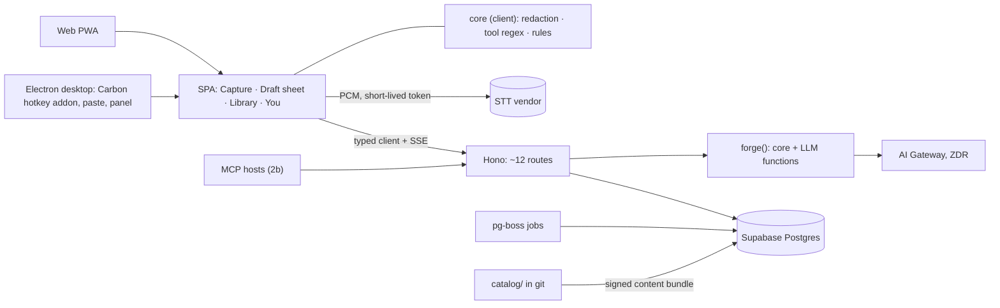

# PromptAI blueprint

**Approved by the owner on 2026-11-11 with every Appendix B default; on 2026-11-13 the owner changed B1 to Electron.** Revised 2026-11-11 with the wave 2 evidence: 17 prototypes, 10 research reports and two checker passes (`EVIDENCE.md`, spot-checked in `VERIFICATION.md`). Wave 1 (2026-11-10) was the chief architect's revision of the merged draft after three critiques: simplicity, feasibility, and user value and safety. The base is **Radical simplicity** (RS), with grafts from **Local-first** (LF) and **Learning flywheel** (FW). Evidence comes from `blueprint-work/research/`, `current/`, `spikes/`, `gh api`, models.dev and primary pages fetched today. The spikes use synthetic users or a loaded M5, so they show direction, not proof; wave 2 grades each result A/B/C, and its timings are upper bounds unless a checker re-ran them on a quiet machine. Every threshold is a starting value to refit on beta logs.

## Design lineage

**What came from where.** **RS (base):** TypeScript-first, one SPA, one server image, no request-time agents, counts not training, IntentFrame, Tool Cards. **LF:** data classes, the "Ran on" label, the G-P canary gate, on-device Parakeet, Tauri. **FW:** decision rows, empirical-Bayes cohort priors, consent tiers, a holdout, now **scale-gated** (§8). **Critiques:** walking skeleton, owned-signal metrics, insertion safety, destination-aware memory, accessibility, i18n, unpreselected consent (Appendix A).

**Contradictions resolved**

| # | Conflict | Decision | Evidence |
|---|---|---|---|
| 1 | Tauri vs Electron | **Electron** (owner decision, 2026-11-13), with one small Carbon N-API addon for key-up and paste and a Swift helper for Apple speech; nothing above `PlatformPort` changes. One language end to end and no Rust owner, for a ~110 MiB larger download | Handy (MIT, 38.3k★) uses its own `handy-keys` hook on macOS/Windows, the Tauri plugin only on Linux (`settings.rs`); Electron `globalShortcut` fires on press only ([docs](https://www.electronjs.org/docs/latest/api/global-shortcut)). `spikes/electron-shell`: Electron 45 is a 112 MiB download vs 5–9 MiB for Tauri builds, but the runtime gap is only +25–27 MiB with the same idle CPU and first paint |
| 2 | Sync | **Plain REST, idempotent event POSTs; no sync endpoint; transient DB errors return 5xx so clients retry** | `spikes/local-first-sync`: last-writer-wins lost a counter increment. Wave 2: CRDTs only move conflict choices into Lamport counters, and acknowledging deadlocks with 2xx dropped 212 writes when two devices reconnected (0 with 5xx) |
| 3 | E2EE | **Honest labels**: at-rest encryption, transactional delete; Evolu vault only if asked | Keys in Postgres don't crypto-shred backups; WebAuthn PRF gaps ([MDN BCD](https://github.com/mdn/browser-compat-data/blob/main/api/CredentialsContainer.json)) |
| 4 | Where learning runs | **Server-side in `/v1/forge`**; core stays pure for a later move to devices | Every forge needs the server |
| 5–6 | Pooling; bandit | **EB cohort priors, hierarchical Thompson sampling, a factored Bayesian linear model for configurations, decay toward the prior; all scale-gated** | Bandit sim: pooling regret 0.21, frozen 0.11, EB 0.095; hier. TS 14.4 vs per-arm Beta over 108 arms 72.0. Wave 2 (`bandit-sim`, reproduced): the EB prior cuts regret 35.9→14.4; per-arm Beta over combinations is no better than a fixed default; refits from raw pooled counts kill personalization |
| 7 | Prediction | **Frecency tool chip; per-user Markov-2 next steps (2a)**; CtxMix deferred | Real Unix logs hit@1: Markov-2 0.358, CtxMix 0.339, LightGBM 0.336; CtxMix's synthetic win is circular (`gen_synth.py`). Wave 2 checker: a frozen lookup reaches 0.740 on the synthetic set, and on Unix data dual-rate CtxMix beats Markov-2 by only 0.008 |
| 10–11 | STT; cleanup | **One cloud vendor (one DPA), chosen by S3; rules cleanup; Apple speech as the free offline engine on macOS 26 and iOS; an on-device English final pass in 2d, runtime chosen by measurement; S1-mini TRIAL** | No realtime product scored yet. Parakeet TDT v3 (parakeet-mlx) ties Whisper on English (7.9% vs 7.5% WER) at 2–6× the speed; whisper.cpp took 1.25–1.67 s while the owner used the desktop, missing 600 ms. S1-mini 8-bit runs 171 ms p50 / 254 ms p95 on a quiet M5 (checker re-run); its accuracy vs Qwen3-4B is not significant, and it made 10 meaning errors vs 3 for rules on 60 items |
| 18 | Ask Gate | **No question step in the MVP; pick chips; one spoken question on voice/mobile (2c)** | `e7_closed_form.md`: desktop gate +0.1 U, voice/mobile +4.2–4.5; `e3_sensitivity.md`: with rubber-stamping (×0.6) asking wins +4.0. Wave 2: the gate under-asks when its assumed catch rates are wrong (chips-only can lose up to 7.1 points), so catch rates are measured per slot before the gate relies on them |

Also settled: no agents at request time; pg-boss; BYOK custody retired (`routes.ts:863-877` misroutes keys); Sentry and SQL views, Langfuse later; Tier 0 safety plus `risk`, Tier 1 with sharing; no tools or egress on the request path ([lethal trifecta](https://simonwillison.net/2025/Jun/16/the-lethal-trifecta/)); MCP in 2b; PWA now, one Capacitor app in 2c; daily or weekly conditional GETs for freshness; 10 cards, 6 families, generic card; 18+ via a date-of-birth (DOB) screen; FIRE cut. Wave 2 adds: no in-house GUI or browser agent (Agent Briefs and typed channels only); no third-party executable plugins; train nothing in the MVP; the server owns slot state for every client, MCP included.

## 1. North star

**PromptAI is a personal intent layer with a tool coach built in.** You speak or type a rough ask wherever you work. PromptAI picks the target tool, fills in what you forgot as chips you can flip, and hands a finished brief to that tool without submitting it. It learns your defaults, vocabulary and skill per tool, and fades its help as you improve. The core object is a **Brief** compiled against a **Tool Card**; prompts, recipes, tips and Agent Skill exports are renderings of it.

**North star: weekly successful users**, the WAU who completed at least two *tasks done well* that week. It counts people, not volume. A task is done well when it is:
- **assisted:** a brief was inserted or copied and then kept, judged on signals PromptAI owns (no Refine, regenerate or undo within 2 minutes, no re-dictation, no "didn't work"), or rated "worked"; or
- **graduated:** the user's raw input already met the card's must-checks and was sent as-is.

An unobserved copy never counts as good. On copy-only surfaces (web copy, mobile share, MCP), one explicit rating is sampled per ~20 tasks. Metrics are reported per surface with an `observable` flag.

**Co-primary: unassisted quality**, the share of a card's checklist the raw input already covers. It must not fall for users past 4 weeks of tenure, or PromptAI is building dependence. Unrestricted AI help lowered later performance in Bastani et al., PNAS 2025 (`learning-science.md`).

**PromptAI is not** a chat destination, a prompt score or a game; an executor (no FIRE, no computer use: it never runs its own GUI or browser agent, and later acts only through typed channels up to the target app's native draft); a course catalog, cloud memory engine or prompt-ops tool; surveillance (no keylogging, screen or clipboard watching, location, or reading other apps without per-app consent); or an auto-submitter.

## 2. Users and jobs

| Segment (in order) | Job | Wedge |
|---|---|---|
| AI-heavy knowledge workers (ChatGPT, Claude, Cursor, Gemini) | "Say it roughly; get an ask whose first answer is usable" | **Speak-it-right** (MVP) |
| Non-native English and Hinglish speakers; people with RSI | "I think faster in speech, sometimes in my language; give me clean text, hands-free" | Speak-it-right, voice commands, locale packs, mixed-script capture (MVP). OS models give this segment little: no Hindi in Apple Foundation Models, SpeechTranscriber or Chrome's Prompt API |
| Privacy-bound professionals (legal, consulting, journalism) | "My words stay on my machine" | Local audio through Apple speech on macOS 26 (B20) and the 2d final pass; local-only history (2d); full Device-only needs a local LLM (later) |
| New-tool adopters (teachers, small businesses, university students 18+, older adults) | "A real first result in an unfamiliar tool within 10 minutes" | **First win** plus coach (2a) |
| Repeaters | "Re-run my weekly job by voice" | **Recipes** (2a) |

Desktop comes first. `personas-jtbd.md` scored dictation-anywhere and the gap check 36/42, recipes 34 and the coach 32. Coverage of every field comes from family cards and a generic fallback, not from per-field code. Health administration is not marketed: the terms prohibit PHI until a BAA path exists, and an on-device chip flags text that looks like patient data.

**Launch cards** (owner to confirm): ChatGPT, Claude, Gemini, Cursor, Claude Code, Perplexity, Midjourney, Gmail, Google Docs, Notion.

## 3. Core loop and feature map

The loop is **Capture → Understand → Draft → Hand off → Learn → Coach**. Every step is bounded, and every feature has a removal test (starting thresholds).

| Feature | Tier | Remove or rethink if |
|---|---|---|
| Hold- or toggle-to-talk into any app and in the PWA; Verbatim/Clean/Prompt; vocabulary; voice commands | MVP | — (core) |
| Draft sheet with provenance, assumption and pick chips, "Covered for you" (≤5), "Why this is better" | MVP | Shown assumptions lose to polish-only dictation (kill check, §19) |
| Insert or copy (never submits); receipt with "Did it work?"; Library; You; "Ran on" label; "Report this output" on every generated artifact; an Agent Brief dialect for agent targets (prefilled, never submitted) | MVP | — |
| Guest mode (device-bound daily quota) | MVP | Abuse >10% of LLM spend, or <10% of guests sign up |
| L1 context-keyed slot counts; frecency tool chip; 10 cards, 6 families, generic card | MVP | Chip-flip rate flat with tenure after 6 weeks |
| Coach (Explain, autonomy dial, First win, cited Q&A), Skill Map, teach-a-tool, recipes and SKILL.md export, memory proposals, next-step chips; Windows | 2a | Recipe reuse in week 2 <10%; next-step kept-rate <15% |
| Remote MCP server | 2b | <5% of WAU after 6 weeks |
| One Capacitor app (share-in, OS intents), App Intents generated from the MCP catalog, one spoken question | 2c | Mobile <10% of WAU after 8 weeks |
| WXT text chip; on-device English final pass (runtime chosen by measurement) with Apple SpeechTranscriber fallback; S1-mini cleanup TRIAL; local-only history; consented `observeEdit` | 2d | Extension <10% of tasks; `observeEdit` opt-in <20% |
| Bandits, holdout, cohort priors, claim credit, lexicon, GEPA | Phase 3 (§8 gates) | Gate never reached |
| Second mobile app, Android IME, team recipes, Companion, Device-only with local LLM, E2EE vault | later | — |

## 4. System architecture

**Layers.** Thin shells (PWA, Electron; later Capacitor, WXT, MCP hosts) do OS integration only. `apps/app` is one React 19 + Astryx SPA reaching the OS through `PlatformPort`. `packages/core` is pure TypeScript with no I/O, run inside `/v1/forge`; the client imports only redaction, tool regex and rules cleanup. `apps/server` is one Hono image (`ROLE=http|worker`, ~12 routes, AI SDK 7, pg-boss). Data lives in Supabase Postgres; the catalog in git.

**Vendors (MVP):** Supabase, one container host, Vercel AI Gateway, one STT vendor and Sentry. Each is a named subprocessor.



**A forge request.**
1. The client redacts the `ContextEnvelope` (surface, host app, tool hint, selection, field text, capture target, language context; later `captures[]` carrying OCR text, pixels only with `includeImage`, always marked untrusted) and resolves the tool by regex (100% of named tools, 0.8% false-tool rate; wave 2: 0.993 main / 1.000 hard, while small LLMs invent tools, `spikes/on-device-intent`).
2. `POST /v1/forge` opens SSE. The server loads the card, ranks up to 8 memories filtered by the card's `audience`, and adds slot counts.
3. Core strips disfluencies, then `understand` streams the IntentFrame; core sets a slot's source to `said` only when its value is grounded in the user's words. Chips render within 800 ms.
4. `compose` renders the Brief IR through the card deterministically, then makes at most one LLM pass over the issues the renderer lists (first token ≤1.5 s p50); checks, `verify` and at most one repair follow.
5. `done` returns the coverage map. Each choice writes a decision row (shown, chosen, outcome, policy_version).

**Monorepo** (pnpm, Turborepo, mise):

```
apps/      server · app · desktop (Electron) · extension (WXT, 2d) · mobile (Capacitor, 2c)
packages/  contract (Zod 4 → OpenAPI, hey-api, MCP schemas, events) · core · ai · platform · ui (Astryx; a11y: announce, StreamRegion, Command Registry) · db (Drizzle)
native/    the one mobile app's share/intent code
catalog/   tools/<id>/{SKILL.md, card.yaml, evals.yaml} · families/ · locales/<bcp47>/ · channels/<id>.yaml · routes.yaml · flags.yaml
evals/     promptfoo · asr/ (Python: jiwer, 133-clip harness) · replay · simulators
docs/      adr/ · runbooks/ · archive/
```

**Do not build:** microservices, Kubernetes, Kafka, workflow servers, sync engines or endpoints, CRDTs, graph or vector DBs, self-hosted gateways or GPUs, envelope-key systems, client policy bundles, a second design system, Python outside `evals/asr` (and `training/` once a student is attempted, §16), an in-house GUI agent, on-device vision models (5–26 s and 3 GB in wave 2), third-party executable plugins, Expo DOM screens.

## 5. Platform strategy

One Astryx 0.7.12 bundle runs everywhere; native code exists only for OS entry points.

| Platform | Shell | Native code | Astryx tier | Phase |
|---|---|---|---|---|
| Web | Vite SPA + vite-plugin-pwa | none | Tier 1 on Chrome 125+, Safari 26+, Firefox 147+; anchor polyfill ([support](https://astryx.atmeta.com/docs/browser-support)) | MVP |
| macOS | Electron | N-API addon: Carbon `RegisterEventHotKey` (press and release) and CGEvent paste; clipboard restore; a `type: 'panel'` window; Swift helper over stdio for Apple speech | Chromium, Tier 1 | MVP |
| Windows | Electron | `globalShortcut` plus a keyboard-hook addon for key-up; SendInput paste | Chromium, Tier 1 | 2a |
| Linux | Electron, best effort | Wayland: compositor keybinding + CLI trigger | possibly Tier 2; web build offered | Tier 2 |
| Chrome/Edge/Firefox | WXT MV3 | none | chip in plain CSS with Astryx tokens | 2d |
| iOS 17+ **or** Android | Capacitor (re-baseline on 9 in 2c; 9.0.0-beta.0 shipped 2026-10-28) | iOS share extension + App Intents, or Android share + PROCESS_TEXT; never AccessibilityService | iOS 26 Tier 1; 17–18 Tier 2 | 2c |

**No iOS keyboard.** Apple's guide says custom keyboards have no microphone access ([archived](https://developer.apple.com/library/archive/documentation/General/Conceptual/ExtensibilityPG/CustomKeyboard.html); current status *unverified*; a 2026 forum report says a keyboard extension gets no microphone even with Full Access). If one is ever built, its containing app records, and nothing is sold inside it. **Mobile wrapper:** Capacitor is confirmed; Expo DOM (4.9× larger, 1.2–4.3× slower to render) and Tauri mobile (no push, in-app purchase or audio plugins) are rejected (`spikes/astryx-mobile-web`).

**Hotkeys and permissions.** The main process starts recording on the addon's key-down and stops on key-up; the renderer captures and streams. First run on macOS registers a standard combo through Carbon `RegisterEventHotKey`, which needs no Accessibility grant: the wave 2 sandbox probe registered press **and** release handlers with no prompt (no physical key was pressed; S2 confirms), so hold-to-talk works from the first run. The mic is asked at the first hold and Accessibility at the first insert (CGEvent paste needs it); the grant also unlocks modifier-only keys such as Right Option through an event tap. Under Secure Event Input, event taps go deaf, so the Carbon registration stays as the shadow. On Windows, UIPI blocks paste into elevated apps: fall back to copy. On Linux, key-up needs the `input` group. Set `backgroundThrottling: false` on the capture window and keep the panel visible in a session.

**Why Electron** (owner decision, 2026-11-13, replacing the Tauri default): one language end to end and no Rust owner; Chromium on every desktop, so the SPA renders the same everywhere; mature packaging (electron-builder, notarization, differential updates). The cost is a ~110 MiB larger download (Electron 45 is 112 MiB to download and 259 MiB installed; published Tauri builds are 5–9 MiB), while the runtime gap is small: +25–27 MiB (1.3×) with the same idle CPU and first paint (`spikes/electron-shell`). Mitigations: bundled packages kept out of the asar (−60 MiB), a sandboxed renderer with context isolation, blockmap differential updates and an 8-week Chromium update cadence. `globalShortcut` reports key-down only, so key-up and paste come from a ~100-line Carbon N-API addon (estimate), never uiohook-napi (needs Accessibility, wraps LGPL code). S2 now checks the Electron shell's capabilities (key-up, panel focus, paste into the 10 apps) and measures `phys_footprint` over all processes (`electron-shell/bench/procstat.py`), not RSS.

**`PlatformPort`** exposes `caps` {hotkey, holdToTalk, insertAtCursor, localStt {engines, locales}, shareIn, secureStore, observeEdit, capture, ocr, a11y facts}, `audio`, `insert(text, target) → inserted | pasted | copied | declined`, `store` and `secrets`. Screens read `caps`, never the platform.

**Insertion rules.** (1) Paste with clipboard restore, skipped when `NSPasteboard.accessBehavior` is ask or deny (Handy's module, with its stale-paste fix and transient clipboard markers: nspasteboard types; `ExcludeClipboardContentFromMonitorProcessing` on [Windows](https://learn.microsoft.com/en-us/windows/win32/dataxchg/clipboard-formats)). Then copy plus a toast. AX insertion only for allowlisted Cocoa apps, verified by readback. (2) Record app, pid, window and field at capture; if they differ at insert, ask "Insert into <app>?" or copy. (3) Never press Enter; strip trailing newlines; terminals get copy or one bracketed paste; never insert into secure fields.

**Extension mic (2d).** Offscreen documents "can't be focused" ([Chrome](https://developer.chrome.com/docs/extensions/reference/api/offscreen)), and Firefox has no offscreen API. The mic is therefore granted once from a visible extension page; Chrome then records offscreen and Firefox in the sidebar. The chip ships text-only first. If the grant fails S1, it hands off to the desktop or web app. The extension receives selectors and a closed list of insertion strategies only; Liquid rendering stays on the server, since MV3 and Apple 2.5.2 allow remote data, never remote logic.

**Distribution:** macOS notarized outside the Mac App Store. The reason is App Review, not the sandbox: in 2026 reviewers rejected dictation apps that insert text via Accessibility or posted events under 2.4.5 (developer reports, `research/w2-app-store-policy.md`), while the sandbox let posted events through 15/15. A Mac App Store "Lite" (Carbon hotkey, copy, the user presses ⌘V) stays possible from a channel profile. **Channel profiles** fix `caps`, the paywall and consent at build time, and CI rejects symbols a channel forbids; store builds carry no BYOK. Signed Windows builds with an updater; mobile store builds only.

## 6. Intelligence layer

**LLM functions**, Zod-typed with versioned prompts; each retries once and returns `Degraded` instead of throwing: `understand` (cheap: the frame), `compose` (standard: the brief), `verify` (cheap, another family: "must" items), `clean` (cheap: Clean mode, after S8), `answer` (standard, 2a: coach Q&A), `learn` (cheap, batch, 2a: proposals).

**IntentFrame.** It replaces intent classification, clarification and the 11-node schema. Impact, fixability and options come from family-pack data (seeded from `config/clarification-questions.json`); the model returns only what it can know.

```ts
type IntentFrame = {
  family: string;                                   // e.g. 'image.generate', 'generic'
  target: { toolId: string|null; source: 'context'|'named'|'predicted'|'none' };
  goal: string; deliverable: string; successCriteria: string[];
  slots: { id: string; value: string|null;
           source: 'said'|'memory'|'count'|'default'|'inferred'|'captured';  // core sets 'said' only when grounded
           confidence: 'low'|'med'|'high' }[];
  coveredForYou: { text: string; slotId?: string }[];   // ≤5
  unsure: { start: number; end: number }[];             // low-confidence dictated spans
  language: { uiLocale: string; spoken: string[]; script: string; register: string;
              replyLanguage: string; targetLanguage: string; numberingSystem: string };
  risk: 'none'|'sensitive'|'refuse';
};
```

One SimToM-style step asks "what does this person know and have?" S5 checks that accuracy rises with each confidence level before the levels drive chips. Wave 2: a small model's yes/no "needs clarification" judgment is unreliable (Qwen3-4B fell 0.787→0.625 on a length-decorrelated set); extracting slot values and grounding them in the request held 0.85 on both sets, but choosing which slot to ask about was right only 30–50% of the time, and filler words make complete requests look vague. S5 adds paraphrased slots and a second rater.

**Chips, not questions (MVP).** Every unstated slot renders as an assumption chip. A slot becomes a **pick chip** when its impact is 3, its confidence is low and no count or memory backs it (at most 2 per draft). A pick chip is a highlighted placeholder that must be resolved before Insert; one tap accepts the suggestion. This handles rubber-stamping without a resumable question flow. Answers patch only that span through `refine`; "Just draft it" accepts every suggestion. The beta measures catch rate passively (assumed slots later edited in their own span). **2c** adds one spoken multiple-choice question on voice and mobile, using the closed-form gate with fixed ρ = {mobile 0.6, voice 0.8}, askCost = {1.5, 2} and no learned λ, switching to measured per-slot catch rates once the beta logs them. Until then the gate runs in its draft mode (1–1.7 questions per voice session): with miscalibrated catch rates, chips-only lost up to 7.1 points while asking ~1.7 questions lost at most 2.2 (`question-selection-sim`). This removes today's flows, which lose answers in 33–53% of sessions (`e4_repo_loops.md`; confirmed at `HEAD`: `build/page.tsx:139` clears the answers on every round).

**Composition.** A Tool Card (`card.yaml` + SKILL.md, prototyped in `spikes/prompt-representation/cards`) declares family, version, `verified_at`, `review_by`, `audience` (`private_ai | human_recipient | shared_doc`), fields with limits and grammar, slots, sourced checks, `compile` instructions, a template, quoted sources and `tos.insert_allowed`. One mapper renders every card. "Covered for you" is capped at 5, since specifying all requirements "does not consistently help" ([arXiv 2505.13360](https://arxiv.org/abs/2505.13360)). The UI shows coverage ("covers 7/8, 2 assumptions"), never a score.

**Brief IR** (`spikes/prompt-representation`). `compose`'s contract is a Zod Brief IR: a closed core, open `facets`, `params` and `tool_params`, and provenance; v0.2 adds `constraints[].scope`. Each card's render section holds parameter rules, a negation strategy, `requires`, `ignores`, Liquid fields or JSON bodies, and an optional vendor schema. A ~330-line LiquidJS renderer compiled 10 fixtures to 8 targets at ~0.5 ms with 0 errors in 16,000 fuzz renders, and four targets were added after a code freeze with 0 changed lines. 30 of 32 pairs need no LLM; the renderer lists what does (positive rewrites of negatives, rules turned into visual descriptions, missing lyrics). The card lint bans range loops and include tags, reads parameters only through `p.*`, and escapes or flags tool-syntax tokens (`--flags`, `[Section]`) in free text before rendering and after the LLM pass: `--ar 1:9 --sref 99999` typed in a subject reached the Midjourney prompt in the spike. The repo's schema gives only 16% of brief content its own slot.

The request path is `compose` → deterministic checks → batched `verify` on "must" items → **one** repair of failing unlocked fields. The checks cover limits, grammar, unsupported features and required content. They also enforce **no unsourced specifics**: every number, date, amount, proper noun, email and URL must trace to the transcript, selection, field text, a memory or a chip, or it becomes a `{{placeholder}}` pick chip. The comparison runs in a script-normalized space (NFC, digit folding, romanization, locale number and day words): naive matching traced 0 of 5 Hinglish details, the normalized check 5 of 5. Ambiguous time words such as "kal" (yesterday or tomorrow) become pick chips, and a number-consistency rule (0 false rejects in 207) applies everywhere. That is 2–4 calls in total, down from 5–12+ today.

**Routing.** `catalog/routes.yaml` gives each function a model list by role, a **pinned thinking mode and effort**, and a token budget that counts thinking. Current Claude models think by default: Sonnet 5.5 runs adaptive at effort `high` and rejects `{type: "disabled"}` (use `between_tools`); Haiku 5.5 runs adaptive at `medium`; API version 2026-10-21 rejects sampling parameters (claude-api reference, cached 2026-10-06). Calls go through Vercel AI Gateway with fallbacks ([docs](https://vercel.com/docs/ai-gateway/models-and-providers/model-fallbacks)); a small adapter maps `routes.yaml` onto its Gateway-specific options, and an OpenRouter hedge is tested once in Phase 1.

| Role | Examples on models.dev today ($ in/out per MTok) |
|---|---|
| cheap: `understand`, `verify`, `clean`, `learn` | Claude Haiku 5.5 (0.10/0.50), GPT-6 Luna (0.10/0.50) |
| standard: `compose`, `answer` | Claude Sonnet 5.5 (2/10), GPT-6.1 Terra (1/5), Gemini 3.8 Flash (0.75/3.75) |
| frontier | escalation only |

Phase 0 picks the actual models, and `verify` must come from a different family than `compose`.

**Routing rules:** ZDR providers only, no free tiers; cache-stable prefixes in the order schema → system prompt → card → user memory → ask (trim today's 2,571-token Brief schema); one model per session; a `user_plan` route class for BYOK and Sign in with ChatGPT, where a 429 is a soft stop, never a silent switch to our keys. **A refusal is terminal:** logged, shown with its reason and a "Report a wrong block" link. A provider's own sanctioned fallback (such as Anthropic's server-side `fallbacks`) may run, but PromptAI never re-sends a refused request to another provider unless Tier 1 rates it benign, and then once.

**Routes-check (nightly)** fails if a routed model is absent from models.dev **or `deprecated`** (models.dev still lists Groq's retired `llama-3.1-8b-instant` and `qwen/qwen3.6-27b` as deprecated), alerts 30 days before listed shutdowns ([Groq](https://console.groq.com/docs/deprecations)), and makes one live smoke call per route.

**Unit economics** (list prices, my arithmetic; S3/S4 measure). A standard-tier forge (3k in, 600 out, thinking off) is ≈ $0.012, plus ≈ $0.0004 for `understand` on Haiku 5.5; the cap is per tier, ≈ $0.005 / $0.02 / $0.04 for cheap / standard / frontier including thinking, because a draft costs ≈ $0.0007 on Haiku 5.5, $0.0139 on Sonnet 5.5 and $0.0278 on Opus 5.5, and a flat $0.02 would block every frontier draft (`research/w2-business-economics.md`). Model-tier routing is the largest margin lever: a device-first hybrid reaches ~79% margin against ~60% cloud-first (usage assumed). STT: Soniox real-time $0.12 per audio hour ([pricing](https://soniox.com/pricing)); AssemblyAI Universal-3.6 Pro Realtime $0.45 per hour of session time, idle included ([pricing](https://www.assemblyai.com/pricing)). A heavy user (1 h of dictation, 10 forges a day) costs ≈ $3.60–13.50 a month in STT plus ≈ $3.80 in LLM, so plans sell quotas of hours and forges. Vendor price is a 4× margin lever and session-time billing adds 17–35%, so S3 ranks on effective $ per hour.

**Device or cloud:** redaction, tool regex, rules cleanup, disfluency stripping, slot grounding and PII chips always run on device; STT runs on device through Apple speech (macOS 26, B20) and the 2d final pass; everything else stays in the cloud until a local provider exists. A task-level `DeviceAI` port exposes `capabilities(task, lang)`, makes one device attempt and then goes to the cloud, and "Ran on" records the model version. Measured options (`EVIDENCE.md`, on-device table): Qwen3-Embedding-0.6B + logistic regression routes the task family at 0.876 / 0.95 in ~50 ms (1.2 GB); Qwen3-4B with JSON constraints scores 0.907 / 0.95 at ~1.4 s and 3 GB, with 0 invalid outputs in 1,590; Apple Foundation Models was not measured (Apple Intelligence off; 4,096-token context on macOS 26.6, no Hindi). No Phi Silica: Microsoft removes it in January 2027 ([Learn](https://learn.microsoft.com/en-us/windows/ai/apis/phi-silica)).

## 7. Dictation pipeline

**Capture.** Hold to talk, or tap to toggle (the first-run default, kind to RSI); no automatic end-of-turn detection; the mic is live only while the key is held or a visible session runs. Desktop and web both capture in the renderer at the device rate and resample to 16 kHz in an AudioWorklet, since Firefox ignores `sampleRate` ([bug 1388586](https://bugzilla.mozilla.org/show_bug.cgi?id=1388586)). One VAD (Silero; `@ricky0123/vad-web` on the web) runs before **every** engine and drops silent clips: Whisper turbo produced text on 3 of 3 silent clips, and the gate fixed all three with no speech lost. A known-phrase and repeated-n-gram filter after every engine fails closed.

**Never lose words.** The utterance's PCM stays in memory, never on disk, until its text is inserted or discarded (≤5 min). If the stream fails, the audio is re-sent automatically to the vendor's batch API ("Recovering…"), else kept for Retry. The last transcript stays in Library for re-insert (not in Incognito). The promise: "Audio is never written to disk or kept on our servers; you can donate a single clip."

**Engines.** The engine is fixed before recording, and text already shown is never swapped. Language is chosen before the engine, and no English-only engine ever receives Hindi audio.
- **MVP: one cloud vendor for streaming and batch.** S3 tests Soniox stt-rt-v6, AssemblyAI Universal-3.6 Pro Realtime, ElevenLabs Scribe v2 Realtime and Sarvam Saaras v4 on `spikes/asr-testset` (133 clips; its scorer reproduced exactly, but 105 clips are TTS, so it is a smoke set, not a leaderboard) plus 50 Indian-English and Hinglish and 100 pure-Indic clips. Streams open on key-down and close on release. **Pass/fail first:** no training on customer audio, zero or short real-time retention, a signed DPA, EU/India regions or SCCs. **Then rank** by WER per locale slice, key-term recall, latency (≤700 ms p50) and effective $ per hour including session and minimum billing. Soniox stores no audio or transcripts unless asked and never trains on them ([security](https://docs.soniox.com/security-and-privacy)); the others are *unverified*. The vendor is named in consent and `data-map.yaml`; a new provider triggers re-consent.
- **Apple speech (macOS 26, iOS 26; Phase 1 if B20 says yes, else 2d).** SpeechAnalyzer runs from an unbundled binary with no permission prompt, 35–60× real time, with a ~0.1 s tail from key release to text (`spikes/asr-apple`, reproduced). SpeechTranscriber (11.5% WER; human English 3.3% vs 4.0% for Whisper; no Hindi; ignores `contextualStrings`) is the free offline English fallback. DictationTranscriber is the only Apple Hindi path (28.9% WER on read Hindi, Devanagari only) and the only one with vocabulary biasing (`contextualStrings` ≤100, ≤5 reserved locales; key-term recall 39→60%). Both run through a Swift helper over stdio. Neither is the default for jargon or 0 dB noise.
- **2d: desktop on device.** Parakeet TDT 0.6B v3 (CC-BY-4.0) as an English final pass, with a waveform instead of partials. On parakeet-mlx it ties Whisper turbo on English (7.9% vs 7.5% WER), inserts nothing on silence and takes 0.13 s warm for a 5 s clip, stable under GPU load; it costs a 2.39 GB download and 3.1 GB with `mx.set_cache_limit` (12.3 GB uncapped). **The runtime is chosen by measurement:** transcribe.cpp, parakeet-mlx and FluidAudio on 0 dB WER, warm latency with a foreground app using the GPU, footprint and download size with quantized weights. The int8 sherpa-onnx build of the same weights collapsed at 0 dB (64.8% vs 25.5%). whisper.cpp turbo q5_0 (7.5% WER, 0.9 GB) is a cross-platform fallback only: its 30 s window puts a 5 s clip at ≥0.40–0.59 s, and 1.25–1.67 s while the desktop is in use. No NVIDIA Open Model License weights ship, so Nemotron-en streaming is excluded; Nemotron 3.5 (openmdw-1.1; 8.7% Hindi and 20.2% Hinglish WER, on 22 clips) waits for a licence read. Hinglish stays in the cloud.
- **Later:** FluidAudio (iOS), sherpa-onnx (Android), Moonshine v2 tiny as a low-end fallback.

**Post-processing.**
1. **Rules as locale packs** (`catalog/locales/<bcp47>/`): numbers with locale grouping (1,00,000 in en-IN), "new line", fillers, replacements, "scratch that", and Hinglish forms ("naya line", "cancel karo"). Rules scored 63% exact with 3 meaning errors on 60 items, and 50% with 5 on the 20-item holdout.
2. **Cloud `clean`, Clean mode only,** once S8 shows it beats rules on meaning errors on the same 80 items. If its output contains a content word or name absent from the transcript and vocabulary, or fails the number check, a light clean wins (fillers, casing, end punctuation). The wave 1 ">40% of tokens" guard is dropped: it fired on correct self-corrections and never caught a kept stale value ("Send it to John"). It gets one attempt. Prompt mode skips it, because `compose` rewrites anyway.
3. **S1-mini 8-bit on desktop: TRIAL** (English-only, MLX, 0.83 GB; Apache-2.0 plus a term requiring the name "S1-mini" by "Superwhisper", B21). 70% exact on 60 items and 80% on the 20-item holdout, 171 ms p50 on a quiet M5; one attempt with `max_tokens = 2×input + 64`, behind the guards above. Prompted general models of 2B or less did worse than rules and translated or invented content; Qwen3-4B needed a gate, a guard and 3.6× the memory.

**Modes and commands.** Verbatim, Clean and Prompt, with "Show original" one tap away; `understand` reads verbatim text and word confidences, since hedges reveal uncertainty. The **output language** can differ from the spoken one, and the sheet says what changed. Dictation while the sheet is open first matches a locale-pack grammar ("insert", "copy", "just draft it", "cancel", "change tone to formal"); anything else becomes a Refine instruction, so the loop works without a mouse.

**Vocabulary.** Vocabulary memories, tool terms, names in context and words corrected twice, ranked by recency × frequency × app match. Parakeet gets a stable per-user lexicon through `boost.words` (key-term recall 52→77%, as good as a per-clip oracle list). Whisper gets a prompt only per utterance, English only, ≤224 tokens, since a global prompt doubled Hindi WER and made MLX loop. Every engine is followed by a space-insensitive lexicon match (about +10 points of recall for free), and key-term recall is gated per locale. The user sets cleanup per app; PromptAI may suggest one once ("Use Clean in Slack?") and never experiments on inserted text.

**Latency targets:** mic live ≤100 ms; first partial ≤300 ms; release → text ≤700 ms p50 via cloud, ≤600 ms on device; insertion ≤50 ms. Latency is measured while a foreground app uses the GPU: with the owner on the desktop, whisper.cpp ran 2.1–2.8× slower while Parakeet stayed within 10%.

**Evaluation.** Online: undo, re-dictation, "show original" and Refine rates; uWER only where `observeEdit` is consented, never as a reward. Offline: jiwer with both normalizers and `--ref-field intended`, Indic-safe normalization (the stock Whisper normalizer deletes Devanagari vowel signs; voi-oiwer for any published Hindi number) and paired bootstrap CIs on the human slices, over the harness (regenerate the truncated syn-plain-05 and -08), FLEURS-hi, en-IN and donated clips, per locale and accent slice: key-term recall, Hinglish mixed-script error, silence hallucination, self-correction, and latency on the team's machines per release.

## 8. Learning and personalization

**Method.** Nothing is trained: counts, small Bayesian posteriors and text memories in `packages/core`, run on the server. Bandits are one-step RL; full RL (PPO, GRPO, DPO) needs traffic and an owned model, so it waits until bandits plateau. No per-user LoRA, reward models, federated learning or vendor fine-tuning. Wave 2 agrees: a Qwen3-1.7B LoRA student tied the S1-mini pipeline but made 3× the rules' meaning errors, which its validation loss hid. A student, when attempted, uses an Apache-2.0 open-weight teacher: Anthropic's Commercial Terms D.4 bar using the Services "to train competing AI models", and whether a cleanup student competes is for counsel. Deletion is handled by retraining without the data.

**Scale gates.** A 50-user beta producing ~5 tasks per user per day (an assumption) logs ~7,500 tasks a month across all decisions. Detecting a 5-point lift in kept rate (0.60 → 0.65, α 0.05, power 0.8) needs ~1,470 outcomes per arm, by the two-proportion formula. Off-policy estimates need more.

| Mechanism | Switches on when |
|---|---|
| L1 counts, explicit memory, memory proposals, skill counts, frecency, Markov-2 | always |
| Session switchback (10% of sessions use priors only; disclosed to beta testers) | the beta, to measure lift with few users |
| L2 bandits, propensities, SNIPS/DR (G4) | a decision point projects ≥1,500 outcomes per arm within 4 weeks (~1k WAU) |
| User-level holdout | ≥4,000 WAU; a 10% holdout (400 users) then detects a 0.15 SD lift at 80% power |
| L4 cohort priors | per cell, once k ≥ 20 users contribute |
| Claim credit; population lexicon | ≥50 cards and k ≥ 20 per claim; ≥20 correcting users per term |
| GEPA | ~10k forges a week for that tool |
| Signed policy bundles | once policies run on device |

Before the gates open, learning is judged within each user: chip-flip and "default overridden after insert" rates by tenure, tested per user with a sign test across ≥20 users.

**Learners.**
- **L1 slot counts:** a Dirichlet per (user, family, slot) **and context** (tool × host or project × recipient class), backing off to the context-free count; pseudo-count 2, half-life 30 days. An explicit pick, flip or answer weighs 1.0, as does a kept chip the user opened or whose task went well; a chip kept without opening weighs 0 until the catch rate is measured, because learning from silent assumptions self-confirms (`question-selection-sim`). Personal p is capped at 0.85 on impact-3 slots, so they always show as assumptions. A count from another context is labelled ("usually formal in Gmail"). A pin is a setting.
- **L3 preferences** (CIPHER-style, [arXiv 2404.15269](https://arxiv.org/abs/2404.15269)): `learn` turns draft→final diffs into one-sentence `memory_items` proposals (kind = preference); low-risk style ones auto-promote after 3 repeats, with undo.
- **L5 skill:** Beta(covered unaided, missed) per (user, tool, checklist item). Help fades with the posterior mean: worked example below 0.4, hint to 0.8, then nothing. It feeds the Skill Map.
- **L2 bandits** (hierarchical TS: global → cohort → user) pick the card variant (≤3), coach card form and route tier × effort, never inserted dictation text. Configuration choices use a factored Bayesian linear model (~4.5 KB per user), never per-arm Beta over combinations. Posteriors decay toward the prior with a half-life of 50–100 interactions (tune on logs). Greedy primary suggestions are allowed only if secondary-slot outcomes update the same posterior (greedy choice stranded 37–74% of simulated users on a wrong option). New tools get a wide prior and their own exploration budget. TS is chosen because its offline evaluation stays reliable when the reward model is wrong; LinUCB had ~10% lower regret under drift (correct `learning-flywheel.md` §8.2 to match). **L4 cohort priors:** nightly proper EB over content-free counts, with posterior covariance, a variance floor and prior strength capped near 20 interactions, never raw pooled counts or naive EB (both killed personalization and hid new tools in the sim); ≤1 contribution per user per cell per day; new accounts weigh 0.25 for 7 days; a cell moving >3σ in a day freezes. **L6 GEPA** ([arXiv 2507.19457](https://arxiv.org/abs/2507.19457)) tunes `compile` instructions in CI.

**Evidence.** Cohort priors cut bandit regret ~2.5× (14.4 vs 35.9) with ~5× fewer bad early suggestions; a graded reward beats binary "copied" by 2.7×; doubly robust OPE landed within 0.5–2.4% of the truth (`bandit-sim`, reproduced). In the question sim, verified signals lifted first-draft slot accuracy from ~73% to ~95% by session 5, but with stable preferences, so context-switching and rubber-stamping users join the regression sims before that claim is relied on.

**Rewards** (bandits only, weights validated by off-policy evaluation): kept on owned signals 1.0; small in-sheet edit 0.6; rewrite 0.2; regenerate 0.1. Thumbs and "worked?" are ≤25% of the blend, since approval rewards drove GPT-4o's sycophancy (secondary sources); dwell time is never used. On voice and mobile, "no edit" is not success. **Guardrails** outside the reward block any promotion that worsens them: abandonment after viewing a draft (later a weak negative), safety flags, length, questions per kept output, time to first kept output. **Exploration** comes only with bandits: secondary slots (alternatives 2–3, "also try", tips), checked candidates, ≤1 per screen, none in frustrated sessions, a 3% floor, no diversity slot.

**Safeguards.**
- **Holdout:** withholds only implicit learned defaults, never explicit memory, vocabulary or settings; rotates every 8–12 weeks; disclosed in the terms; excludes paid accounts.
- **Reward hacking:** real outcomes > deterministic checks > human pairwise > LLM checklist; no holistic score; cross-family judges with hidden anchors (one study saw judge pass rate rise 0.72→0.94 while accuracy stayed 0.20, [arXiv 2607.05904](https://arxiv.org/abs/2607.05904)); sycophancy probe and length penalty on every promotion.
- **Lock-in:** decay, "not this time", context keys, an other-tool suggestion, explicit settings as hard constraints; `autotuneStrategyProfile` is deleted.
- **Fairness:** `cohort_key` uses only dimensions whitelisted in `data-map.yaml` (family, tool, surface, chosen locale, skill tier), never inferred demographics or accent. Gates report per locale, segment and surface and block a promotion that worsens any slice of ≥k users; ASR error rates differ widely by speaker group ([Koenecke et al., PNAS 2020](https://pmc.ncbi.nlm.nih.gov/articles/PMC7149386/)).

**Promotion (G4, at scale):** golden sets → DR plus SNIPS lower bound above the incumbent with effective-sample-size diagnostics, never IPS alone (in core, property-tested; OBP as an offline cross-check; logs keep the raw Monte Carlo counts and the exact floor mixture; changes to decay or prior refits go to online tests) → shadow → 5% canary → full; rollback is a pointer flip.

**Consent.** **Personalize for me** (L1, memory, skill) is on as part of the service and can be paused. **Help improve defaults for everyone** (priors, claim credit, lexicon) is asked once with equal Yes/No buttons and nothing preselected; skipping means No, which satisfies GDPR and DPDP's "clear affirmative action". **Share this item** donates one brief or clip to the golden sets until withdrawn. A separate `train_models` purpose covers any future student model, and events from a keyboard extension never enter population learning. Content-free events are kept 13 months (owner and legal to confirm).

## 9. Prediction engine

**Targets:** the tool, slot defaults, the next action after a receipt ("shorter", "try in Claude", "save as recipe"), recipe offers and vocabulary.

- **MVP:** frecency per (user, host app, surface), τ ≈ 14 days, with backoff to global, sets the target-tool chip. One other-tool suggestion always shows.
- **2a:** per-user Markov-2 over ~40 action tokens, backed off to Markov-1 and then global with λ = n/(n+20), drives next-step chips. There are no fitted weights. CtxMix, LightGBM and sequence models wait for a ≥0.03 hit@1 gap on beta logs.
- **Show gate:** show only if p > c/(b+c), with b the benefit of acceptance and c the cost of an unwanted suggestion ([Cursor Tab](https://cursor.com/en/blog/tab-rl)). Start at chip 0.25 (≤3), pre-filled default 0.7, unprompted card 0.8 (≤2 a day); each dismissal adds 0.1; three in a row silence the surface for the session. A recipe is offered after 3 repeats in 14 days sharing ≥70% of slots.
- **LLM prediction** happens only inside `understand`: nothing per keystroke, no ghost text.
- **2c:** App Intent donations or `reportShortcutUsed` let the OS handle time and place triggers, so PromptAI holds no location ([Apple](https://developer.apple.com/documentation/appintents/donations-and-discovery)). Predictions never chain actions.

**Metrics:** accepted-and-kept rate, hit@1/3, ECE and dismiss rate. Every suggestion has a "Why?" and a per-surface kill switch.

**Wave 2** (`prediction-sim`) confirms this section: on real Unix commands every model scores 0.32–0.37 hit@1, so prediction starts with counts. Events record stage × tool, host app, local time and session boundaries; p gets isotonic calibration before the show gate relies on it; first-time needs use population priors (k ≥ 20); LightGBM never takes a user-id feature. The host-app signal's real value is measured on opt-in beta logs (2a).

## 10. Memory and knowledge

**User memory.** Each `memory_items` row carries `kind` (profile, preference, rule, fact, goal, vocabulary), `scope` (global, tool, project), `sensitivity` (normal, sensitive, special), `status`, `text`, `source`, `evidence_ids`, `strength`, `uses`, `helpful`, `superseded_by` and validity dates. The profile card is at most 200 tokens. Data is encrypted at rest in Supabase; delete is transactional with delete-wins tombstones (no upsert can resurrect a forgotten memory), and backups age out within a stated window (*unverified*; check the Supabase plan).

**One store per preference.** Slot-mappable preferences live only in L1 counts, and a pin is a setting. Free text, including L3 proposals, lives only in `memory_items`. "Why?" therefore explains each chip from one source.

**Write policy.** Explicit statements activate at once; vocabulary updates automatically with undo; inferences become proposals (≤3 per session, ≤10 pending, expire after 14 days, back off after dismissals), emitted by the post-session `learn` job as ADD / REINFORCE / UPDATE / SUPERSEDE / NARROW_SCOPE / NOOP. **Nothing is written from pages, docs, imports or MCP** (document-borne poisoning succeeded up to 99.8% of the time, arXiv 2605.15338). **Special-category data (GDPR Art. 9) is never inferred**; user-stated sensitive items are injected only when request tags match; `risk: 'sensitive'` requests create no proposals, signals or cohort contributions.

**Retrieval** (no embeddings): score = 0.4·keyword + 0.2·scope + 0.3·decayed strength + 0.1·pinned; top 8 (~300 tokens); precedence message > project > tool > global > inferred. `applied_memory_ids` drive "Used 3 memories", "Why?" and "Not this time". If retrieval misses, add on-device embeddings (Qwen3-Embedding, with an `embedding_model` column and a romanized shadow index: romanized-Hindi recall@1 0.93 vs 0.50 for potion-multilingual); embeddings never leave the device ([Vec2Text](https://arxiv.org/abs/2310.06816)).

**Destination rule.** For `human_recipient` or `shared_doc` cards (Gmail, Docs, Notion), only style and preference memories shape the text, and profile, fact and goal memories never appear verbatim. At insert, memory-derived spans are flagged ("2 details from your memory") with a one-tap strip.

**Tool Atlas.** Each tool lives in `catalog/tools/<id>/`: SKILL.md (a valid Agent Skill); card.yaml (fields, grammar, slots, checks, `audience`, edges `requires / alternative_to / integrates_with / supersedes`, and claims with a literal source quote, `valid_from/to` and `review_by`); evals.yaml. CI rejects a quote that is not a literal substring of the cached source, and card text that coaches safeguard evasion. Unknown tools get the generic card ("no verified card yet"). Catalog-sync is the only writer to `catalog_items` and `passages`; coach Q&A uses Postgres full-text search over `passages` (seeded from 89 cited PKB chunks), with pgvector off unless recall@5 < 0.8.

**Librarian (job, 2a).** One generic TypeScript pipeline (fetch, robots.txt, Readability, Turndown; no headless browser) discovers docs by llms.txt → help-center API → sitemap → link crawl; in `spikes/tool-ingest` it built cited profiles for five very different tools from a small config each. Conditional GETs and section hashes over an allowlist (vendor SKILL.md repos, llms.txt, docs, release feeds) recheck on a schedule set by measured churn: Claude Code, Figma and Midjourney daily (one request each), Suno weekly, Excel monthly; conditional GETs cut recheck bytes 98–99.5%. It obeys robots.txt; a bot wall (the real blocker, not JavaScript) stops the crawl and falls back to an official API or user-supplied docs. Text in docs that is addressed to AI agents is stripped. Output is one weekly GitHub issue (~30 min to triage) of changed sections, models.dev diffs and vendor-skill pushes; a human edits cards, and card PRs pass promptfoo evals. Decay is real: of 18 audited claims, 2 are contradicted and 1 is gone (`registry-audit.json`); wave 2 found Midjourney's default is now V8.2 and 8 of 13 docs URLs have moved. LLM claim extraction, claim credit, MCP reading, Crawl4AI and an arXiv radar wait for ~50 cards or triage over 30 minutes.

**Teach-a-tool (2a).** A pasted docs URL goes through the same pipeline and becomes a private card with quote-verified claims. Wave 2 verified 214/214 quotes over 5 tools, but the spike agent itself did the extraction, and parameter precision fell from 84.8% to 60% (Claude Code) and 33% (Figma) on a fresh sample, so production grounding is unmeasured. Extraction therefore makes deterministic parameter tables only for tools whose docs are catalogs (CLI flags, function lists), checks claim support with an LLM or NLI model, never lexical overlap (which caught 0 of 2 contradictions), keeps contradicting claims with their dates, and emits two tiers: a small card, plus a parameter table and a hashed section index.

## 11. Agent runtime

**No agents at request time.** `forge()` is a plain async function under a `Budget` of {4 calls, 2,500 output tokens including thinking, 20 s, the tier's $ cap (§6)}; its only loop is one repair. A fast-check property over 10k sessions asserts termination within 4 calls, always with a result. This replaces the Supervisor, PipelineGraph and the 13 agents.

**Guards:** per-call timeouts (p95-tuned), gateway fallbacks, a daily per-user cost ceiling in Postgres, idempotency keys. Degradation ladder: fallback model → cheap tier → card template → the frame with its chips. **At a quota**, the current utterance always finishes and is inserted with rules cleanup; no work is discarded, no upsell appears mid-task, and remaining quota shows before the limit.

**Run record.** With a donation or debug consent, each call stores input hash, model, settings and an output reference; `evals/replay` re-runs requests against new cards or routes.

**Jobs** (pg-boss, same image): `learn`, nightly `routes-check`, daily `retention`, `librarian`; later `priors`, `claim-stats`, `optimizer` (GEPA, CI-only). They are scheduled jobs, not agents, writing only rows, issues and PRs.

**MCP (2b).** `@modelcontextprotocol/server` 2.4 on Hono (stdio and HTTP, both spec eras; the spike passed 82/82 Inspector checks) exposes `forge_brief`, `refine_brief`, `explain_tool`, `record_outcome` and `my_recipes`. `forge_brief` returns the brief, assumptions and pick slots as structured output with a signed `requestState` for `refine_brief`, so the host model asks. The `requestState` is required and carries the ids of slots already asked and the round count, and the server enforces the cap: against the stateless spike, where the two-call cap was only prose, an agent that forwarded only the latest answers cycled on 4 of 4 ideas. A regression test sends only the latest answers and leaves one P1 question blank; `input_required` is used only with clients that negotiated 2026-07-28 ([changelog](https://modelcontextprotocol.io/specification/2026-07-28/changelog)). Load-test with two instances; `spikes/mcp-server` passes Inspector on both spec eras. The App card follows ([MCP Apps](https://modelcontextprotocol.io/extensions/apps/overview)); design for Slackbot's 60 s timeout. An MCP client and a Companion agent come only with CaMeL-lite. Questions return as data with `next_action`, output schemas and readable errors, since elicitation is optional and the Messages API sees tools only; nothing essential lives only in resources or prompts; the Node heap is capped and the stdio entry kept lean (2026-era clients spawn it twice); a host that brings its own model gets a deterministic scaffold. **Auth:** verify that the Supabase OAuth server supports CIMD, DCR, S256 PKCE, refresh rotation and the Claude and Cursor callback URLs, or use an external authorization server.

**Hand-off and the outward surface.** An `Action` type, a Tool Card `handoff` block and `decideExecution()` exist from Phase 1; there it always returns `handoff`, and every call is logged. ADR: no in-house GUI agent (top agents still fail ~1 task in 7, and a 20-step GUI task costs $0.45–1.29 against $0.0125 for a typed call, `research/w2-agentic-execution.md`). Agent targets get an Agent Brief, prefilled and never submitted. The MCP catalog generates App Intents (2c), Windows App Actions and later Android AppFunctions; each is read-only or confirms before acting.

## 12. Data, backend and auth

**Tables (12, replacing 28):** `profiles` (+ `handle`, `trust_level`), `memory_items`; `artifacts` (+ `visibility` default private, `license`, `indexable`, origin ids, `published_version_id`, `share_slug` absorbing `share_links`, `skeleton_hash`, `moderation_state`), `artifact_versions` (immutable, head pointer); `events` (append-only, monthly partitions, with an origin tag and the language dimensions); `decisions` (point, context, shown, chosen, outcome, policy_version; propensities once randomized); `policy_state`; `catalog_items`, `passages`; `usage_counters`, `subscriptions`; `audit_log` (append-only, content-free, the `004_audit_immutability.sql` pattern). Plus pg-boss's tables; `cohort_priors` arrives with its gate. Drizzle from a clean baseline; UUIDv7 IDs; tombstone deletes; pseudonymous `pid`.

**No sync engine.** Personal data is REST CRUD through TanStack Query (optimistic updates, IndexedDB read cache). Writes carry idempotency keys; events are batched with retry. **Acknowledgement rule:** 2xx plus a rejected-op log only for permanent validation errors, so queues never stall; 5xx on transient SQLSTATEs (40P01, 40001, 55P03) so clients retry, optionally with `pg_advisory_xact_lock(hashtext(user_id))` per write transaction. Acknowledging deadlocks with 2xx dropped 212 writes when two devices reconnected at once (`spikes/local-first-sync`, reproduced on plain Postgres); counters derive server-side from events. Local-only history (2d) uses SQLite in the Electron main process (`node:sqlite`). PowerSync (Apache-2.0 since 2026-11-03) is the path if a measured offline-editing need appears (it converged 20/20 locally). CRDTs stay out: they decide conflicts by Lamport order or peer id, drop edits inside deleted objects and resurrect forgotten memories.

**Endpoints:** `/v1/forge`, `/v1/refine`, `/v1/answer` (SSE); `/v1/dictation/{token,transcribe,clean}`; `/v1/events`; `/v1/me/*` (CRUD, export, transactional delete including the auth user); `/v1/catalog` (ETag-cached bundle); `/mcp`; `/webhooks/stripe`; role-gated `/admin/*`. OpenAPI from `@hono/zod-openapi`; clients from hey-api.

**Hosting:** two container instances on Fly.io or Railway (pricing *unverified*), Supabase Pro, a CDN. Lambda, SSM and the in-memory caps are retired.

**Auth.** **Guest mode** is device-bound and stateless (no memory), with ALTCHA proof-of-work and a small daily quota; after the first kept brief it offers "Sign up to keep this". Accounts use Supabase Auth (email OTP, Google, Apple) with PKCE; the extension uses `launchWebAuthFlow` with refresh tokens; desktop and mobile use deep links. A neutral DOB screen (no pre-checked box) precedes any use, and store age ratings match. MCP OAuth uses the Supabase OAuth server's dynamic client registration ([docs](https://supabase.com/docs/guides/auth/oauth-server)); its Client ID Metadata Document support is *unverified*. Stripe stays. Entitlements live on the server behind a paywall that adapts to each storefront; nothing is sold inside a keyboard extension. A consent ledger covers cloud ASR, each LLM vendor, reading page context, learning and training, and generates every store's disclosures from `data-map.yaml`.

## 13. Safety, privacy and security

**Data classes** (in `data-map.yaml`, checked in CI and by G-P; legal pages written by hand): **P** personal (Postgres, or device only); **T** transient (a redacted slice to a named ZDR provider); **C** catalog (public, signed); **A** aggregates (content-free, k ≥ 20); **D** destination (text inserted into other apps, tagged by `audience`).

| Threat | Control |
|---|---|
| Prompt injection | Untrusted text goes in a spotlighted block. There are no tools and no egress on the request path. CaMeL-lite and AgentDojo cases arrive with the first tool |
| Memory poisoning | Writes come only from user-authored evidence or confirmed proposals |
| Hand-off leaks | Destination rule; flag-and-strip at insert; a G-P canary for `human_recipient` cards |
| Wrong insertion target | Capture-target check; terminal and secure-field rules; transient clipboard |
| Harmful requests | A Tier 0 floor (CSAM, minors, NCII) that fails closed; the `risk` field; terminal refusals. Tier 1 arrives with shared recipes, using a guard on a ZDR host (Vercel lists gpt-oss-safeguard; not via Groq before its DPA) or omni-moderation named in consent |
| Evading a tool's safeguards | Covered in the AUP and Tier 0; catalog lint; G1 red-team cases; an appeal path with consented review |
| PII, secrets, PHI | On-device detectors (Luhn, Verhoeff, PAN, IBAN, SSN, email/phone, secretlint, patient-data pattern) raise "Redact?" chips; no content in logs or URLs |
| Learning poisoning, Sybils | Caps, k ≥ 20, probation weighting, 3σ freeze, quote-verified claims |
| SSRF | `assertPublicHttpUrl` extended to 100.64/10, IPv4-mapped and NAT64; DNS pinned |
| Cost abuse | Daily ceilings; ALTCHA and device quotas for guests |
| Output abuse | "Report this output" with published contact details on every generated artifact (Apple 1.2, revised 2026-10-16); takedown reason codes, `noindex` and revocable slugs on share links, which may already carry EU DSA duties |
| Poisoned docs and cards | Strip agent-directed text from crawled docs; a card-text lint for Unicode tag characters, bidi controls, zero-width characters, base64 and imperative patterns |
| Captures (later) | OCR redaction with NFKC, confusable folding and whole `KEY=` lines (OCR noise defeats regex, and no regex caught names), names as keep/remove chips; a low-contrast hidden-text filter (caught a hidden instruction, 0 false flags in 172 lines) |
| Supply chain | SHA-pinned actions, zizmor, gitleaks, a licence rule (no AGPL/SSPL/BUSL/GPL shipped; NVIDIA OML, the S1-mini naming term and openmdw read case by case), pnpm `minimumReleaseAge` 1440 min and provenance on direct dependencies, CI hardened against TanStack-style compromises, signed builds and TUF-lite bundles (§16); BYOK only in the OS keychain, never in store builds |
| Overclaiming | The label says "Encrypted at rest; processed transiently by named AI providers"; "E2EE" is reserved for a future vault |

**Privacy controls (four):** Incognito per session (memory neither read nor written, no history); Personalize for me; Help improve defaults for everyone; and History location (synced or this device only, from 2d). Plus per-item Forget, Export and Delete account. Five users must explain each control correctly before launch.

**Compliance:** 18+ via the DOB screen; Apple 5.1.2(i) consent naming each AI and STT provider, with re-consent when one is added ([guidelines](https://developer.apple.com/app-store/review/guidelines/)); 5.1.1(v) in-app deletion; EU AI Act Art. 50 disclosure; a DPIA for voice and profiling; DPDP affirmative consent; check whether Google Play's [AI-generated content policy](https://support.google.com/googleplay/android-developer/answer/14094294) applies (*unverified*); Groq only after its DPA is signed.

## 14. Quality

**Metrics:** weekly successful users and unassisted quality; good-task rate per surface; sent-as-is rate; time to first kept brief; chip-flip and "default overridden" rates by tenure; abandonment after view; week-4/8 retention. All are sliced by locale, segment and surface. The Critic's self-graded score is retired.

| Gate | When | Blocks on |
|---|---|---|
| G0 | Every PR | tsc, Biome, dependency-cruiser (the baseline only shrinks), Knip, Vitest + fast-check (termination, idempotency, unsourced specifics), schema, contract and event diffs. UI PRs add: first-load JS ≤320 KiB gzip per route, Lighthouse mobile ≥85 and accessibility 100, no new touch target under 44 px for coarse pointers, a CSS layer-order check, virtual screen-reader tests (≤3 announcements per brief), axe plus content-loss, forced-colours and keyboard checks at 320, 390 and 1280 px in both themes, pseudo-locale screenshots, an offline lazy-route test; MCP PRs add the Inspector matrix |
| G1 | Prompt, card or route change | promptfoo: 15–20 owner-written and synthetic cases per tool, growing through donations, including unsourced-specifics, injection and evasion cases. Blocks on a deterministic failure, cost +20% or p95 +25%. The pairwise judge is advisory until κ ≥ 0.6 on ~200 owner labels |
| G2 | Nightly | Full golden set; the ASR table per locale, latency measured with a foreground app on the GPU; routes-check with smoke calls; judge drift; real VoiceOver and NVDA runs through Guidepup; the regression sims (miscalibrated-gate users, an MCP agent that forwards only the latest answers, two devices reconnecting with 1,000 operations each) |
| G3 | Release | Rollout 5 → 25 → 100% with automatic off on a breach; manual VoiceOver, NVDA, Voice Control and Voice Access passes on 10 journeys |
| G4 | Learned artifacts | §8, at scale |
| **G-P** | Every release | mitmproxy as the system proxy plus Electron's network log (`--log-net-log`), with canaries in personal data. Fails if a canary reaches any host except the gateway or STT vendor, shows up in telemetry, or appears in `human_recipient` inserts. Web journeys run in Playwright. Desktop journeys run through Playwright's Electron support |

**Eval budget:** a G1 run is ~200 cases × (≈$0.013 forge + ≈$0.01 judge), about $5, so nightly runs cost ~$150 a month. PR runs cover only the tools that changed. The runner aborts past a cap of $250 a month in Phase 1.

**Eval hygiene:** a second rater on the intent and cleanup sets and a 5-gram leak check. Every wave 2 eval set had a single author, and one spike's hand count disagreed with its own automated counter.

**Observability:** OTel GenAI conventions (pinned names); Sentry; SQL views over `events` that suppress cells under 20 users and show bootstrap CIs. Langfuse comes in when consented content traces are needed.

## 15. UX and UI system

**Four places:** Capture, Draft sheet, Library and You, plus a ⌘K palette. Every surface opens the same **Draft sheet**: a target chip with one "also try" tool; the brief, read-only (the user's words in full ink, inferred text muted, dotted-underlined and aria-labelled, never colour alone); assumption chips (3–6 options plus "Something else", each redrafting only its part) and pick chips; a collapsed "Covered for you" and the coverage line; **"Why this is better"**, an annotated before/after from the coverage map with no extra call; the "Ran on" label (a popover of exactly what was sent, 2a); Insert (⌘↵), Copy, Refine, Edit, Save as recipe. *Edit* switches to plain text and drops provenance; Lexical nodes come only if beta users edit in place. After hand-off the sheet becomes a receipt with "Did it work?" and, from 2a, one next step.

**Principles:** draft first, every assumption visible; pick chips answer by number key, tap or voice; "Just draft it" always visible; undo toasts, not confirm dialogs; never auto-submit; "Why?" and Forget on every suggestion; a weekly "Learned this week"; ≤1 tip per task and 3 a day; the autonomy dial defaults to **Show me why**, and Coach me never auto-applies "Covered for you"; ≤100 ms echo, ≤1 s first token, Cancel after 10 s ([NN/g](https://www.nngroup.com/articles/response-times-3-important-limits/)); reserved layout for streams; Hallmark floor (tokens only, instant focus rings, reduced motion, no emoji icons or invented metrics).

**First run:** DOB → provider consent → a first brief as a guest. The mic is asked at the first hold and Accessibility at the first insert; no tour and no account until something is worth keeping. Target: median install → first inserted brief ≤2 minutes.

**Accessibility and i18n.** Target WCAG 2.2 AA (Astryx states no level, `astryx-ui.md`). Streams make status-only announcements through one `announce()` adapter (`ariaNotify`, else `useAnnounce`; WKWebView lacks `ariaNotify`), with a setting "Speak while drafting: Off / Sentences / Everything" (a hand-rolled live region made 249 announcements per stream; today's `MicButton.tsx:53` makes 26 for 28 words); a Command Registry gives each action one spoken name shared by its label, shortcut, palette entry and voice command; muted ink and accent stay ≥4.5:1 in both themes; every action works by voice and keyboard; toggle-to-talk is offered at first run; 2–3 assistive-tech users join the beta. Strings are externalized from Phase 1 with Lingui (3.6 KB) and `Intl` under Astryx's RTL-aware `InternationalizationProvider`; text direction comes from a script table, user text gets `dir=auto`, and we write our own Indic catalogs for Astryx's 641 string keys.

| Screen | Astryx template · components |
|---|---|
| Capture, desktop panel | `ai-chat-landing` in `shell-side-nav`, Electron `type: 'panel'` window · `ChatComposer`, `ChatDictationButton` via `useForgeDictation()`, `Kbd`, custom `LiveWaveform` |
| Draft sheet | `editor` · read-only `Markdown` with provenance spans, `Popover` + `RadioList`, `CollapsibleGroup`, `Citation`, `Toast`, custom `PromptDiff` (jsdiff) |
| Library; You | `table-filter`; `settings-sidebar` · `PowerSearch`, `EmptyState`, `Switch`, `Table` with bulk Forget, `AlertDialog` |
| Coach Q&A; Skill Map (2a) | `ai-chat`; `dashboard-scorecard` · `ChatMessageList`, `Citation`; per-item dumbbells with an 80% band and a table twin, no overall score |

**Template notes (0.7.12).** `table-filter` and `dashboard-scorecard` call `stylex.create`, so they need the StyleX compiler or a rewrite. `editor`, `settings-sidebar` and `ai-chat` set their root to `100dvh`, which becomes `100%` inside the shell. Coach Q&A is not built on `ChatMessageList` until its `role=log` live region can be overridden (it announced 0–1 times per stream). Undo toasts must not auto-hide (Astryx defaults to 5 s).

**Astryx setup:** prebuilt CSS + Tailwind v4 with `@layer reset, theme, base, astryx-base, astryx-theme, components, utilities;` first, no StyleX compiler; one `forge` theme via `defineTheme({extends: neutralTheme})` with an accent pair, light #b23809 (6.06:1 on white; today's #d9480f is 4.30:1) and dark #f08c5a (7.74:1 on #111111, where #b23809 is 3.11:1), my WCAG calculations; 36/44/48 px coarse-pointer controls; pin 0.7.12 (Lexical follows its `^0.52.0` peer) and upgrade fortnightly with `npx @astryxdesign/cli upgrade`, gated by Playwright screenshots (10 screens, both themes, 375/1280 px) and axe; swizzle ≤3 components, each with an ADR. **Policies** (`spikes/astryx-*`): `LayoutContent isScrollable={false}` (it breaks sticky positioning); `neutralProfile: custom` for warm neutrals; one icon set; per-component imports (barrel imports in server components cost 2.7× the JS); `astryx.css` imported outside the Tailwind entry with no duplicate `theme.css` (3–9× faster hot reload); self-hosted fonts; a colour-mode script before hydration; overrides for fixed-size parts; a wrapping chip row; multi-line list rows; one coarse-pointer theme rule (54 of 54 controls were under 44 px). Astryx's own floor is 155 KiB JS plus 45 KiB render-blocking CSS, so mobile LCP was 3.6–4.1 s (Lighthouse 87–90); prerender the capture shell if it must fall below 2.5 s. Astryx also runs on Next 16 + Tailwind 4 (+81 to +155 KiB gzip per route), so it is no reason to leave Next; the Vite SPA rests on the desktop and mobile shells. If `web/` is migrated in place, rename its `--color-accent` first.

## 16. Engineering principles

**Boundaries** (dependency-cruiser in CI): `contract` is a leaf; `core` has no I/O (no fetch, `Date.now`, env or DOM; a Clock port instead); adapters and apps never import each other; no cycles; the licence rule passes. 12 files break the README's layering rule today; the new baseline is 0.

**Plugins are data.** Cards, families, locales, routes, flags, recipes and site selectors are Zod schemas with `schema_version`, shipped as **one signed content bundle** through one pipeline, signed TUF-lite: two offline root keys, a delegated CI key valid ≤12 months, a `meta.json` with a monotonic version, ≤30-day expiry, channel, minimum client version and hash, fallback to the last good bundle, and separate keys for the content bundle, the updater and code signing (verification takes 1.6–1.8 ms). Loaders reject unknown fields and keep the last good bundle; one loader replaces ~19 `readFileSync` loaders. Flags have a type, safe default, owner and expiry. No third-party code plugins: extension items are declarative and declare their effects from a closed set (QuickJS's deadline overran ~100× and Extism-JS ignored `maxPages`, so no JS sandbox is trusted). A `training/` uv project is allowed only once a student model is attempted.

**Testing:** Vitest + fast-check; port-conformance suites against fakes and real adapters; PGlite; Zod contract tests; replay of the last two clients; Playwright and WebdriverIO journeys. The spike simulators become regression tests, with rubber-stamping and context-switching users. The 477 Jest tests are mined as specs.

**CI/CD:** one affected-only workflow (actionlint, zizmor, gitleaks, OIDC). The server deploys continuously from main; the content bundle ships through G1 (validate → eval → sign → flip); clients release only when their code changes (electron-builder with notarization and Windows signing, WXT zips plus AMO sources, Fastlane). CalVer, additive-only APIs, a minimum client version.

**Ownership.** Named owners and runbooks for server/core/AI, SPA, the Electron shell (main process, N-API addon, Swift helper), and catalog/evals/triage (the owner, ~2 h a week). With one engineer, increments run strictly in sequence. Swift or Kotlin stays under ~300 lines.

**Coding agents:** `AGENTS.md` per package, imported by `CLAUDE.md`; skills `add-tool-card`, `write-eval`, `db-migration`, `release-desktop`, `astryx-ui` (CLI and MCP), plus Hallmark and dataviz; Astryx MCP in `.mcp.json`; one `pnpm verify`; hooks guarding generated files and applied migrations; ~106k words of planning docs move to `docs/archive/`.

## 17. Open-source adoption

Checked with `gh api` (Hugging Face for weights) on 2026-11-10 (wave 2 rows on 2026-11-11, weights' licences from the Hugging Face API, `VERIFICATION.md`); every repo was pushed on or after 2026-08-04 unless a date is shown; NOASSERTION licences were read from LICENSE or npm.

| Tool | Licence | Verdict |
|---|---|---|
| astryx, stylex, lexical, vite, tailwindcss, recharts, immer; jsdiff, css-anchor-positioning | MIT; BSD-3 | ADOPT |
| electron, electron-builder, node-addon-api | MIT | ADOPT |
| handy-computer/handy-keys | MIT (36★, **2026-08-07**, tiny bus factor) | ADOPT, **vendored** |
| cjpais/Handy (paste and Secure-Input modules, attributed); transcribe.cpp | MIT (38.3k★); MIT (2.2k★) | REFERENCE; ASSESS (2d, unmeasured) |
| electron | MIT | ASSESS (fallback, with a Carbon N-API addon) |
| capacitor (8.6; 9 beta), wxt, vite-plugin-pwa, hono, zod, hey-api, drizzle-orm, pg-boss, tanstack/query, altcha, lingui | MIT | ADOPT |
| vercel/ai; MCP typescript-sdk, ext-apps; supabase, pgvector; agentskills, models.dev | Apache-2.0 (NOASSERTION); MIT→Apache-2.0; Apache-2.0, PostgreSQL; Apache-2.0, MIT | ADOPT |
| ricky0123/vad, silero-vad | ISC (NOASSERTION), MIT | ADOPT |
| Parakeet TDT v3 weights | CC-BY-4.0 | ADOPT (2d) |
| parakeet-mlx; Apple SpeechAnalyzer; superwhisper/s1-mini | Apache-2.0; system; Apache-2.0 + **naming term** ("S1-mini" by "Superwhisper") | TRIAL |
| liquidjs, ajv (standalone), `@modelcontextprotocol/server` 2.4 + Inspector, linkedom, diff | MIT | ADOPT |
| Nemotron 3.5 ASR (openmdw-1.1), Sarvam, whisper.cpp, Loro, PP-OCRv6, winapp CLI | various | ASSESS |
| moonshine | MIT for streaming and English models (some legacy non-English models non-commercial) | ASSESS (v2 tiny as a low-end fallback) |
| jiwer, promptfoo ("now part of OpenAI"), mitmproxy, webdriverio | Apache-2.0, MIT, MIT, MIT | ADOPT |
| opentelemetry-js, sentry-javascript, readability, turndown, robots-parser, secretlint | Apache-2.0 / MIT | ADOPT |
| langfuse; sherpa-onnx, FluidAudio; gpt-oss-safeguard; Qwen3Guard | MIT outside `ee/`; Apache-2.0; Apache-2.0 (**2026-01-14**); weights Apache-2.0 (**2025-10-21**, repo has no licence file) | LATER |
| st-tech/zr-obp | Apache-2.0 (**2024-06-03**) | LATER (cross-check) |
| smokescreen, opendp, ts-fsrs, gepa, model2vec, LightGBM, ollama, florisboard, evolu, powersync | MIT / Apache-2.0 | ASSESS |
| pnpm, turborepo, vitest, playwright, biome, knip, dependency-cruiser, zizmor, gitleaks, fastlane; axe-core | MIT / Apache-2.0 / ISC; **MPL-2.0** (dev-only) | ADOPT |

**AVOID:** uiohook-napi (needs Accessibility, wraps LGPL code), Nemotron-en streaming (**NVIDIA OML**), mlx-whisper 4-bit and faster-whisper on CPU, Kyutai STT and parakeet-mlx's streaming mode, Automerge, Expo DOM and Tauri mobile, Extism-JS and Node `--permission` as sandboxes, Phi Silica (removed January 2027), LoRAX and torchtune (all wave 2); DBOS, Temporal, LangGraph, Smart Turn, cockatiel, Cap-go's updater (**MPL-2.0**), HSTU, Flower (unneeded or wrong scale); LiteLLM proxy (2026 advisories); Firecrawl self-host and Unleash (**AGPL**), Phoenix (**ELv2**), Inngest (**SSPL**), Restate (**BUSL**); VoiceInk, Epicenter, FUTO, TEN VAD, KeyboardKit (GPL/AGPL/non-OSI); NVIDIA Open Model License weights as defaults (**non-OSI**); Crawl4AI for now (**attribution clause**, Python, headless browser); mem0, Letta, Graphiti (ideas only); TensorZero (**archived**).

## 18. Current repo: keep, migrate, retire

Paths are under `/Users/gangadhara/Documents/PromptAI/repo`.

**Fix now (week 1):** re-point `config/model-routing.json` (retired Groq models; done in `38c86ea`, not yet deployed); BYOK rejects instead of misrouting (`backend/src/handlers/routes.ts:863-877`); "just generate" keeps answers (`web/src/app/build/page.tsx`); clarify-resume stops re-running intent and skipped states stop re-asking; `DELETE /me` revokes keys and deletes the auth user; remove the `/try?idea=` leak; fix `push_tags` (`.github/workflows/desktop.yml`); fix the analytics queries (`rubric_scores`, `scripts/improvement-analysis.ts`); harden the existing share links (migration 018: report button, takedown reason codes, `noindex`, revocable slug); fix `MicButton.tsx` (its live region, its label switching and its ~2.5:1 interim-text contrast); correct `code-map.md`'s "never loops" and note the extension's `ClarifyStep` remount; refresh the registry data (Midjourney V8.2, moved docs URLs).

**Keep, as data or specs:** `config/platform-registry.json` → split into a tool profile, a surface-adapter record and a policy record (cards and bundle selectors) (replacing `extension/src/content/detector.ts`) · `pkb-seed.json` → `passages` · `clarification-questions.json` + `docs/clarification-taxonomy.md` → family slots · `strategy-profiles.json` → compile guidance · `library-seeds.json` → recipes and golden cases · `docs/quality-rubric.md` → checklist lint · `PromptSerializer.ts` → templates · `HeuristicScorer.ts` → the unassisted-quality scorer, from day one · `TokenGovernor.ts`, `extractJson`, `templateVars` → core · `DocFetchService.ts` → Librarian, with CIDR and DNS fixes · `insertText.ts` and tests, `widgetGeometry.ts`, `HotkeyManager.swift` (reference) · the `004_audit_immutability.sql` pattern · compliance docs → `data-map.yaml` · `backend/tests` as specs.

**Migrate:** `providers/*`, `ModelRouter.ts` → `packages/ai` + `routes.yaml` · `useDictation.ts` → audio module · `crypto.ts` → legacy migration only · `PlatformProfileAgent.ts` → teach-a-tool · `MemoryExtractionAgent.ts` → `learn` job · `memory_entries` → `memory_items` · `outcome_signals` → `events` (still unlinked from identity) · `feature_flags` → `flags.yaml`.

**Retire:** `handlers/routes.ts` (2,623 lines), `Supervisor.ts`, `PipelineGraph.ts`, `SessionProgress.ts`, the Lambda adapter; the 13 agents (single-prompt services become forge/refine modes); `autotuneStrategyProfile`, `ModelRefreshAgent.ts`, `OpenRouterModelFetcher.ts`, `openrouter-models.json`, `model-capabilities.json`; `KeyCustody.ts` and `provider_connections` after revoking SSM keys; `GroqSTTAdapter.ts`, the crawl-pkb crawler, `FeatureFlags.ts`, `FireService.ts`, regex safety beyond Tier 0; `api-types.ts`, migrations 015/016; and `web/`, `desktop/`, `firefox-extension/`, `macos/`, `macos-sdk/`, `admin/` **only after parity**.

**Cutover.** (1) Phase 0 counts live users and memory rows per client. (2) Old clients run on the old backend until Phase 1 passes, then get a dated end-of-life notice (≥60 days) with export. (3) Legacy encrypted memory: at first unlock the user chooses, with no default, "Keep on this device only (export)" or "Move to Synced (encrypted at rest; our server can process it)". Rows never unlocked trigger emails at 0, 90 and 150 days with an export link and expire at 180. User-linked learning is a new purpose, so existing users see the consent screens. (4) Migrations are idempotent scripts with a dry run; rollback points DNS at the old stack, kept warm 30 days.

## 19. Roadmap

Each increment adds at most one new surface and starts only when the previous one's checks pass. Weeks assume 2–3 engineers; with one, stretch each increment ~1.5×.

**Phase 0 (weeks 0–2): lights on, bets settled.**
- **Scope:** the fix-now list and seven spikes. **S1** Astryx in Chrome, Electron's Chromium, Safari 26 and iOS 18 (PWA) and an MV3 page with the mic grant (Chrome, Firefox), plus touch-target and template checks. **S2** the exact shipping hotkeys (modifier-only, Secure Input) → cloud STT → paste into the 10 launch apps, with focus-change, terminal and secure-field cases, the Carbon key-up test with physical keys, and `phys_footprint`. **S3** STT bake-off, Sarvam and 100 Indic clips included. **S4** two compose models and a merged call on 50 golden cases, thinking pinned. **S5** `understand` on 150 labelled ideas with calibration, paraphrased slots and a second rater. **S6** idempotency and retry property test for `/v1/me/*` and `/v1/events`, plus the concurrent-reconnect test (two devices, 1,000 operations each). **S7** concierge test: a throwaway page calling one model, Draft sheet vs polish-only dictation, 5–8 people from at least three segments. Counsel reads the Nemotron 3.5, S1-mini and Apple-voice terms.
- **Verify:** hourly production smoke draft passes 7 days; BYOK test passes; S1 popovers anchor, 0 serious axe issues; S2 ≥98% of 200 insertions correct per app, ≤700 ms p50, notarized build in under a day; S3 a vendor passes every privacy criterion with the lowest en-IN/Hinglish WER; S4 owner pick with TTFT and cost; S5 macro-F1 ≥0.9, monotonic calibration; S6 10k interleavings converge; S7 people catch or flip assumptions (else redesign the sheet first).

**Week 4: thin slice.** One Mac: hotkey → STT → forge (one card) → paste, behind a dev flag.

**Phase 1 (weeks 3–10): MVP, Speak-it-right on macOS and web.**
- **Scope:** monorepo; server (~12 routes, 12 tables); SPA with four places on PWA and Electron macOS; guest mode, DOB, consent; dictation with recovery, locale packs (en, en-IN, Hinglish), vocabulary, voice commands; 10 cards, 6 families, generic; IntentFrame, pick chips, unsourced-specifics check; L1 context counts; frecency chip; "Why this is better"; events and decisions; Lingui; G0, G1, G-P; S8; "Report this output"; the Agent Brief dialect; the language context; the consent ledger; channel profiles; TUF-lite signing; Apple speech offline dictation if B20 says yes. **10 users on the PWA by week 6.**
- **Verify:** golden checks pass for 10 tools and the owner prefers new output in ≥80% of pairs; first token ≤1.5 s p50, full draft ≤8 s p95; termination property holds; nothing auto-submits; median install → first inserted brief ≤2 min across 10 unassisted testers; a 20–50 user beta (with 2–3 assistive-tech users) records baselines against a polish-only control; ≥99.5% crash-free; each forge within its tier's $ cap; G-P and axe pass; dependency-cruiser baseline 0.

**Phase 2 (v1): four increments of ~4–6 weeks, ordered by beta demand.**
- **2a, learns you and teaches you (Windows):** coach, Skill Map, teach-a-tool, recipes, proposals, next-step chips, egress popover, Librarian. *Verify:* week-2 reuse ≥20%; chip-flip and override rates fall for ≥60% of users with ≥4 weeks; 50-persona memory eval with 0 poisoned writes, <5% duplicates, ≥90% contradictions handled; unassisted quality flat or rising.
- **2b, MCP server.** *Verify:* Inspector in CI, two-instance load test, directory review.
- **2c, one mobile app** with share-in, intents and the spoken question. *Verify:* store approval; the question raises mobile good-task rate in a switchback.
- **2d, extension text chip, on-device final pass (runtime picked by measurement), local-only history, `observeEdit`.** *Verify:* WER within 1 point of cloud and key-term recall within 5 points at ≤600 ms p50 with a foreground app on the GPU; G-P shows local rows stay local.

**Kill check after 8 beta weeks:** go coach-first if week-2 reuse <20%, if assumptions lose to polish-only dictation, or if a host ships cross-tool personal skills.

**Phase 3 (as §8 gates open):** bandits with OPE, holdout, cohort priors, claim credit, lexicon, GEPA; second mobile app; Android IME (FlorisBoard); Tier 1 with sharing; team recipes; custom provider (device BYOK, Ollama, Apple FM) and full Device-only; CaMeL-lite with Companion, typed draft tools behind it, and an MCP client that pins tool descriptions by hash; the first trained student (§8); an Evolu vault if asked. *Verify:* every promotion passes G4 and slice checks.

## 20. Risks

Host and OS absorption (Wispr Flow dictates on Mac, Windows, iOS and Android, [pricing](https://wisprflow.ai/pricing); iOS 27 dictation; host memory), countered by cross-tool intent completion, personal defaults and coaching · synthetic evidence (refit on beta logs) · rubber-stamped chips (pick chips, catch rate, S7) · Electron's download size and Chromium cadence (asar trimming, differential updates, 8-week upgrades) and one native addon to maintain (S2) · Astryx pre-1.0 with ~20 releases in 10 weeks (pin, screenshot gate) · one STT vendor and one gateway (batch recovery, adapter) · iOS review under 4.2 and 5.1.2(i) · model licences (Parakeet attribution, no NVIDIA defaults) · heavy-dictation costs (quotas) · population cold start (scale gates) · noisy rewards (owned signals, sampled ratings) · bus factor (owners, runbooks, sequential increments) · GPU contention on the user's machine (measure with a foreground app) · licence traps (NVIDIA OML, the S1-mini naming term, openmdw) · the unmeasured on-device ASR runtime · App Review inconsistency (2.4.5 enforcement exceeds its text) · macOS pasteboard privacy alerts · Astryx's weight on phones · single-author eval sets · unknown Apple Intelligence enablement rates · the signing pipeline as a target.

## Appendix A: Critique resolution

**Simplicity and engineering**
- **Blocker, roadmap too large:** walking skeleton, week-4 slice; Phase 1 is macOS plus PWA; WXT, MCP, CtxMix, egress popover moved out; v1 split into 2a–2d, one surface each; old clients run until parity. Network-layer G-P stays (cheap) (§19).
- **Blocker, no statistical power:** scale-gate table with power calculation; within-user metrics and switchback; Phase 2 checks measurable at 20–50 users (§8).
- **North star needs read-back:** owned signals, observable flag, sampled ratings; consented `observeEdit` (2d); uWER never a reward (§1).
- **Core on devices plus sync:** core runs in `/v1/forge`; REST CRUD; `/v1/sync`, `rejected_ops`, client bundles removed (§4, §12).
- **Handy-fork rationale:** corrected; no fork; published crates, handy-keys vendored; S2 tests real keys (§5).
- **Device-only hollow:** v1 ships local STT, Incognito, local-only history; full mode waits for a local LLM (§2).
- **Envelope encryption:** dropped for at-rest encryption, transactional delete, a stated window (§10).
- **Dictation sprawl:** one vendor; rules; `clean` after S8; Smart Turn, NVIDIA streaming, S1-mini, bandits, lexicon cut or gated (§7).
- **Full Ask Gate in MVP:** no question step or `input_required`; pick chips; spoken question in 2c with fixed ρ; MCP returns assumptions; merged call in S4. *Partly rejected:* "never ask" ignores e3, so impact-3 low-confidence slots still need a pick (§6).
- **Three preference stores:** one rule; MMR dropped (§10).
- **Freshness machinery:** conditional GETs into one weekly issue; the rest waits for ~50 cards (§10).
- **G1 unmeetable, Python sprawl:** 15–20 cases per tool grown by donations; Python only in `evals/asr`; AgentDojo, Schemathesis, device lab dropped; eval budget (§14).
- **Two store apps:** one app in 2c; no live updates, tile or Swift client generator (§5).
- **Seven trains:** one signed bundle, continuous server deploys, client releases on change (§16).

**Technical feasibility**
- **Hotkeys misdescribed:** handy-keys plus Carbon fallback; recording in Rust; per-OS permission plan; throttling; Wayland binding. First-run combo uses the plugin; S2 confirms no grant needed (§5).
- **AX-first insertion:** paste with restore by default; AX only for allowlisted apps with readback (§5).
- **Extension mic:** visible-page grant; Firefox sidebar; text-first chip; hand-off fallback (§5).
- **$1 cost gate:** $ per forge including thinking and $ per dictated hour by billing basis; quotas (§6).
- **Thinking defaults:** pinned per function, counted in the Budget, reported by S4/S5. *Partly rejected:* no automatic cross-provider retry after refusals (§6).
- **Routes-check misses Groq:** fails on `deprecated`; deprecation pages; smoke calls (§6).
- **G-P on macOS:** mitmproxy plus Rust hook; WebdriverIO embedded driver (§14).

**User value and safety**
- **Blocker, north star unmeasurable and rewarding dependence:** weekly successful users with assisted and graduated tasks; unobserved copies never good; unassisted quality co-primary; on-device, per-app `observeEdit` sends only a ratio (§1).
- **Rubber-stamping:** kept chips weigh 0 unless opened (≤0.2 in wave 1); pick chips; catch-rate measurement; regression sims (§6, §8).
- **Stable preferences, filter bubble:** context keys, 0.85 cap, context labels, switching sim user, override guardrail, "also try" (§8).
- **Hand-off leaks:** `sensitivity`, no special-category inference, `audience`, destination rule, strip at insert, class D, canary, `risk: 'sensitive'` rules (§10).
- **Invented specifics:** deterministic check → placeholders (§6).
- **Wrong target, terminals:** target check, terminal and secure-field rules, transient clipboard (§5).
- **Lost audio:** in-memory buffer, batch recovery (§7).
- **STT privacy:** S3 pass/fail; vendor in consent; re-consent (§7).
- **Dictation bandits:** removed; engine picked offline; cleanup suggested once (§7).
- **Holdout harm:** implicit defaults only; rotated, disclosed, no paid accounts, ≥4k WAU (§8).
- **Default-on pooling:** split consent, nothing preselected (§8).
- **E2EE downgrade:** choice at unlock, three emails, EOL notices with export (§18).
- **Onboarding friction:** guest mode, in-context permissions, ≤2 min target. *Changed:* guests get no memory, avoiding a second store (§12, §15).
- **No users until week 10:** S7 concierge test; 10 PWA users by week 6 (§19).
- **Pure delegation:** "Why this is better" in MVP; Show me why default; unassisted quality from day one (§15).
- **Accessibility:** WCAG 2.2 AA, voice commands, `useAnnounce`, contrast, manual AT passes, AT beta users (§15).
- **English-only:** Lingui, locale packs, Hinglish commands, output-language mode, B4. Tool-name regex unchanged: names are language-neutral (§7).
- **Aggregate-only gates:** `cohort_key` whitelist; per-slice blocking (§8).
- **Refusal shopping, evasion:** terminal refusals, AUP, catalog lint, red-team cases, appeals (§6, §13).
- **Unenforced 18+:** DOB screen, store ratings, 18+ students, no pupil data (§12).

**Minor fixes applied:** CtxMix evidence; IntentFrame trimmed with S5 calibration; Tier 1 deferred; Langfuse, cockatiel dropped; propensities once randomized; four privacy controls; Lexical deferred; no generated legal pages; model roles; Hopp wording; dark accent; transcribe.cpp hotwords and Parakeet default; S1-mini scope; Qwen3Guard hosting; Crawl4AI clause; zr-obp; Firefox resampling; stateless MCP questions; gateway adapter; WER comparison dropped; arXiv 2505.13360 wording; versions; PHI; abandonment guardrail; quota UX. None rejected.

## Appendix B: Decisions for the owner

Each line: decision, then the recommended default. **The owner approved every default on 2026-11-11.**

- **B1 Desktop shell:** Electron, with a Carbon N-API addon and a Swift helper (owner decision, 2026-11-13, replacing the Tauri default)
- **B2 "Help improve defaults":** Ask once, no preselection; skipping means No, in every market
- **B3 Server-held BYOK:** Retire it; offer a custom provider later
- **B4 Markets and languages:** US and India; English UI with en-IN formats; English, Indian English and Hinglish dictation; Hindi UI after the beta
- **B5 STT vendor:** The vendor that passes S3's privacy criteria with the best en-IN and Hinglish WER, Sarvam included, ranked on effective $ per hour (vendor price is a 4× margin lever)
- **B6 Guest quota:** Stateless, with ~10 forges and 10 dictated minutes per device per day
- **B7 Age:** 18+ with a neutral DOB screen; no under-18 or K-12 marketing
- **B8 First mobile platform:** Follow the beta mix: Android if the India segment leads, iOS 17+ if US workers lead
- **B9 Order of 2a–2d:** Windows → MCP → mobile → extension
- **B10 Linux:** Tier 2, with the web build
- **B11 Existing users:** Count them in Phase 0; run old apps until parity; give 60 days' notice with export
- **B12 Legacy encrypted memory:** Ask at unlock with no default; three emails; expire at 180 days
- **B13 Pricing:** Never paywall privacy. Pro at $12/month or $96/year with credits for the frontier tier; no Lite tier; a free tier with on-device dictation; refit after S3, S4 and beta logs (Wispr Flow: $12–15/month)
- **B14 Retention:** Events 13 months; donations until withdrawn; legal sign-off
- **B15 Holdout:** Only at ≥4k WAU; disclosed; paid accounts excluded
- **B16 Health:** Not marketed; no PHI until a BAA path exists
- **B17 FIRE:** Cut until after product–market fit
- **B18 Staffing:** Name the desktop (Electron) owner before Phase 1; owner triage ~2 h/week
- **B19 Launch cards:** The 10 in §2
- **B20 Free macOS dictation in Phase 1:** Yes, through Apple speech, if the owner accepts a Swift helper beyond the ~300-line budget; otherwise wait for 2d
- **B21 S1-mini:** Accept its naming term (credit "S1-mini" by "Superwhisper") and TRIAL it on desktop
- **B22 Entity:** Set up organization identities (Apple, Google, Microsoft) and a Windows signing route for an India-based entity
- **B23 Apple Intelligence on the test Mac:** Enable it so the existing `afm/` CLIs can measure Apple Foundation Models before any device tier
- **B24 Toolchain:** Xcode Command Line Tools build the addon and the Swift helper; full Xcode is needed only for iOS (2c). No Rust

## Appendix C: Evidence

`EVIDENCE.md` holds wave 2's per-item results with A/B/C strength, the dictation-engine and on-device-model tables, the ten decisions the evidence settles and the table of what is still unproven (with how and when to prove each). `VERIFICATION.md` holds the lead's spot checks and corrections for both waves. Raw data and reproduction scripts are under `spikes/` and `spikes/_checks/`.
